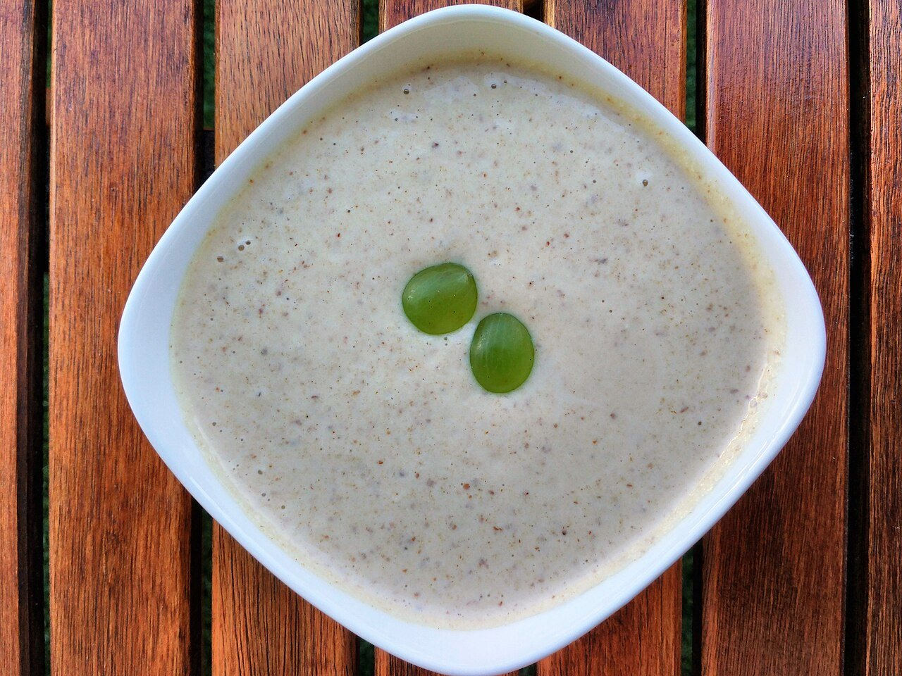

# Málaga-style chilled almond and garlic soup

*Photo: [Popo le Chien](https://commons.wikimedia.org/wiki/File:Ajo_blanco.jpg), [CC0](https://creativecommons.org/publicdomain/zero/1.0/), via Wikimedia Commons.*

🥣 Serves **4** · ⏱️ 15 minutes + 2 hours chilling · Difficulty: easy

*En español:* [Ajoblanco malagueño](ajoblanco-malagueno.es.md)

## Ingredients

- 1⅓ cups (7 oz) blanched raw almonds
- 2 cups (3½ oz) day-old bread, crusts removed
- 1–2 garlic cloves (green germ removed)
- ½ cup extra-virgin olive oil
- 2 tablespoons sherry vinegar
- 3 cups ice-cold water
- Salt
- Peeled muscat grapes or diced melon, to serve

## Directions

1. **Soak.** Soak the almonds in cold water for 1 hour (or overnight) and drain. Soak the bread in water and squeeze it dry.
2. **Blend.** Put the almonds, bread, garlic, a pinch of salt and half the water in a blender. Blend on high until very smooth.
3. **Emulsify.** With the motor running, drizzle in the oil, then the vinegar. Add the rest of the water until it looks like a light cream.
4. **Strain and chill.** For a silky texture, pass it through a fine sieve. Adjust salt and vinegar and refrigerate at least 2 hours.
5. **Serve.** Stir before serving and ladle into bowls with a few grapes or melon cubes and a drizzle of oil.

## Tips

- **Remove the garlic germ:** it keeps the flavor clean and easier to digest.
- **Keep it cold:** add a couple of ice cubes when blending.
- **Keeps** 2 days in the fridge; it may separate a little, just stir.
