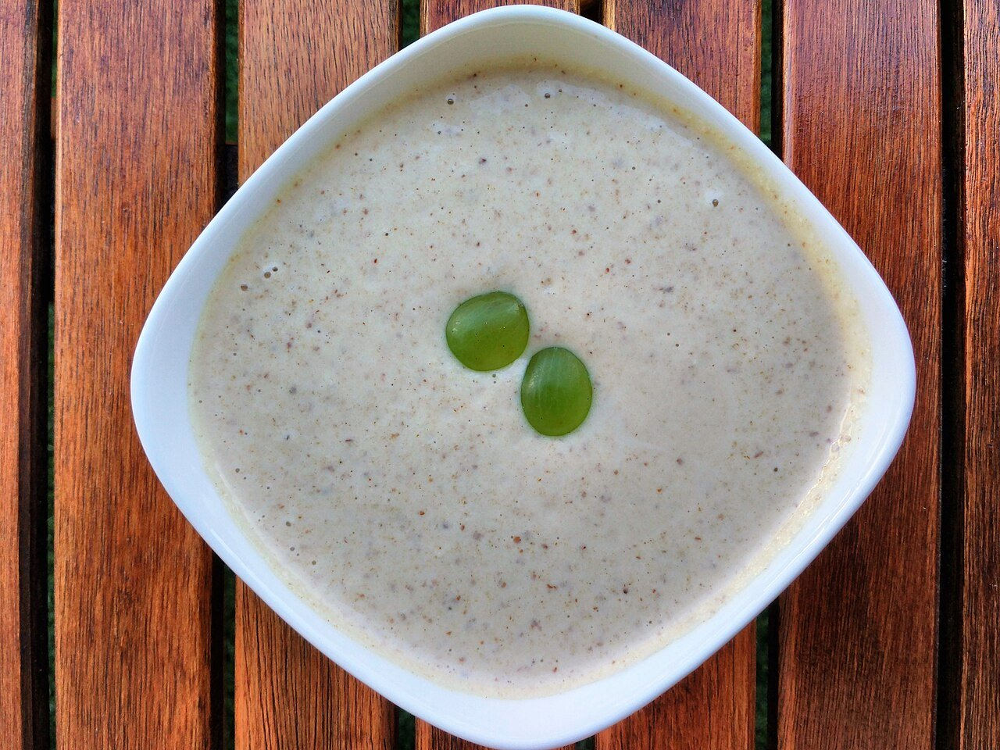

# Ajoblanco malagueño

*Foto: [Popo le Chien](https://commons.wikimedia.org/wiki/File:Ajo_blanco.jpg), [CC0](https://creativecommons.org/publicdomain/zero/1.0/deed.es), vía Wikimedia Commons.*

🥣 Para **4 personas** · ⏱️ 15 minutos + 2 horas de frío · Dificultad: fácil

*In English:* [Málaga-style chilled almond and garlic soup](ajoblanco-malagueno.en.md)

## Ingredientes

- 200 g de almendras crudas peladas
- 100 g de miga de pan del día anterior
- 1–2 dientes de ajo (sin el germen)
- 100 ml de aceite de oliva virgen extra
- 2 cucharadas de vinagre de Jerez
- 750 ml de agua muy fría
- Sal
- Uvas moscatel peladas o dados de melón, para servir

## Preparación

1. **Remojar.** Deja las almendras en agua fría 1 hora (o toda la noche) y escúrrelas. Remoja la miga de pan en agua y escúrrela con la mano.
2. **Triturar.** Pon en la batidora las almendras, el pan, el ajo, una pizca de sal y la mitad del agua. Tritura a máxima potencia hasta obtener una crema muy fina.
3. **Emulsionar.** Sin dejar de batir, añade el aceite en hilo y después el vinagre. Termina con el resto del agua hasta que quede como una crema ligera.
4. **Colar y enfriar.** Si quieres una textura sedosa, pásalo por un colador fino. Prueba de sal y vinagre y mételo en la nevera al menos 2 horas.
5. **Servir.** Remueve antes de servir y reparte en cuencos con unas uvas o dados de melón y un hilo de aceite.

## Consejos

- **El ajo, sin germen:** así no repite y el sabor queda más limpio.
- **Bien frío:** puedes añadir un par de cubitos de hielo al triturar.
- **Se conserva** 2 días en la nevera; puede separarse un poco, basta con remover.
