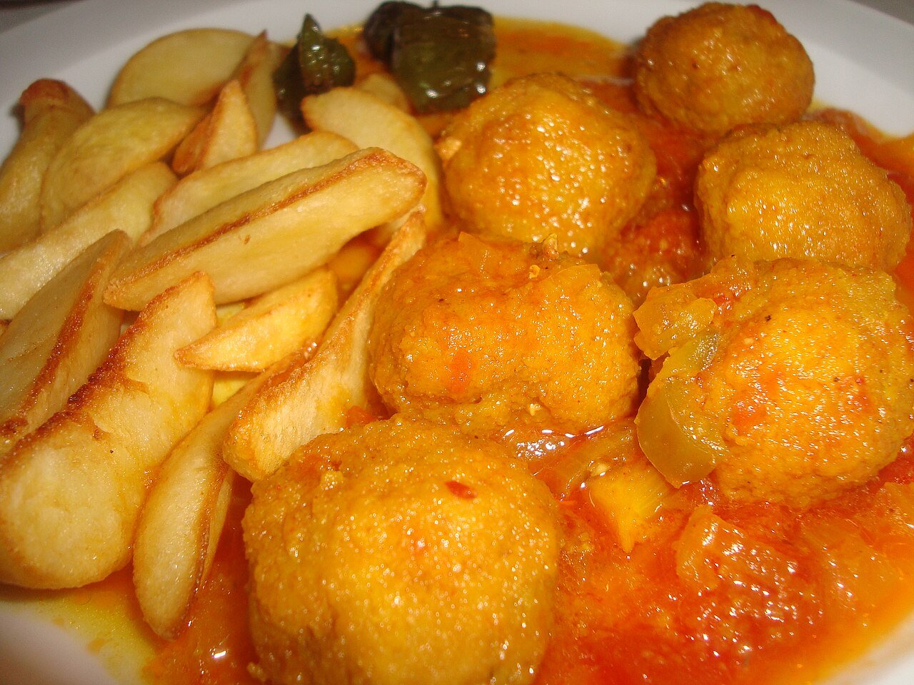

# Spanish meatballs in sauce

*Photo: [Juan Emilio Prades Bel](https://commons.wikimedia.org/wiki/File:Alb%C3%B3ndigas_en_salsa_con_patatas_fritas.jpg), [CC BY-SA 4.0](https://creativecommons.org/licenses/by-sa/4.0/), via Wikimedia Commons.*

🍖 Serves **4** · ⏱️ 1 hour · Difficulty: medium

*En español:* [Albóndigas en salsa](albondigas-en-salsa.es.md)

## Ingredients

**For the meatballs**

- 1 lb ground meat (half beef, half pork)
- 1 egg
- 2 garlic cloves, minced
- 1 tablespoon chopped parsley
- 1 cup (2 oz) fresh bread, soaked in milk
- All-purpose flour, for dredging
- Olive oil, for frying
- Salt and pepper

**For the sauce**

- 1 onion
- 1 carrot
- 2 garlic cloves
- 1 tablespoon all-purpose flour
- ⅔ cup dry white wine
- 1¾ cups beef or chicken stock
- 1 bay leaf

## Directions

1. **Mix.** Combine the meat with the egg, garlic, parsley, squeezed bread, salt and pepper. Chill for 15 minutes.
2. **Shape and fry.** Roll into walnut-size balls, dredge in flour and fry in hot oil just until browned outside. Set aside.
3. **Base.** In a Dutch oven with 3 tablespoons of the frying oil, gently cook the chopped onion, carrot and garlic for about 10 minutes.
4. **Sauce.** Stir in the flour for 1 minute. Pour in the wine and let the alcohol cook off. Add the stock and bay leaf and simmer 10 minutes. Blend it if you like a smooth sauce.
5. **Simmer.** Add the meatballs and simmer, covered, over low heat for 15–20 minutes.

## Tips

- **For juicy meatballs:** don't overwork the meat and don't fry them all the way through; they finish cooking in the sauce.
- **Serve with** diced fried potatoes, white rice or crusty bread.
- **Even better the next day**, like most stews.
