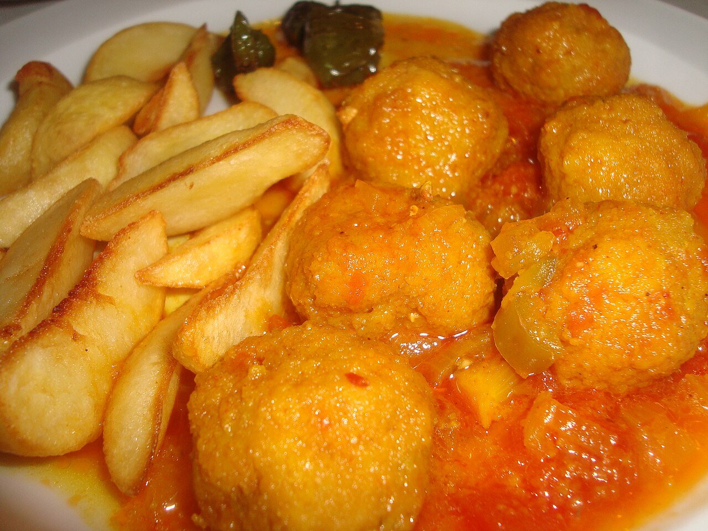

# Albóndigas en salsa

*Foto: [Juan Emilio Prades Bel](https://commons.wikimedia.org/wiki/File:Alb%C3%B3ndigas_en_salsa_con_patatas_fritas.jpg), [CC BY-SA 4.0](https://creativecommons.org/licenses/by-sa/4.0/deed.es), vía Wikimedia Commons.*

🍖 Para **4 personas** · ⏱️ 1 hora · Dificultad: media

*In English:* [Spanish meatballs in sauce](albondigas-en-salsa.en.md)

## Ingredientes

**Para las albóndigas**

- 500 g de carne picada (mitad ternera, mitad cerdo)
- 1 huevo
- 2 dientes de ajo picados
- 1 cucharada de perejil picado
- 50 g de miga de pan remojada en leche
- Harina, para rebozar
- Aceite de oliva, para freír
- Sal y pimienta

**Para la salsa**

- 1 cebolla
- 1 zanahoria
- 2 dientes de ajo
- 1 cucharada de harina
- 150 ml de vino blanco
- 400 ml de caldo de carne o de pollo
- 1 hoja de laurel

## Preparación

1. **La masa.** Mezcla la carne con el huevo, el ajo, el perejil, la miga escurrida, sal y pimienta. Deja reposar 15 minutos en la nevera.
2. **Formar y freír.** Haz bolas del tamaño de una nuez, pásalas por harina y fríelas en aceite caliente solo hasta que se doren por fuera. Resérvalas.
3. **El sofrito.** En una cazuela con 3 cucharadas de ese aceite, pocha la cebolla, la zanahoria y el ajo picados a fuego suave unos 10 minutos.
4. **La salsa.** Añade la harina y remueve 1 minuto. Vierte el vino y deja que se evapore el alcohol. Añade el caldo y el laurel y cuece 10 minutos. Si la quieres fina, tritúrala.
5. **Guisar.** Mete las albóndigas en la salsa y cuécelas a fuego suave, tapadas, 15–20 minutos.

## Consejos

- **Jugosas:** no amases de más la carne y no las frías del todo; terminan de hacerse en la salsa.
- **Con guarnición:** van muy bien con patatas fritas en dados, arroz blanco o pan.
- **Mejor de un día para otro**, como casi todos los guisos.
