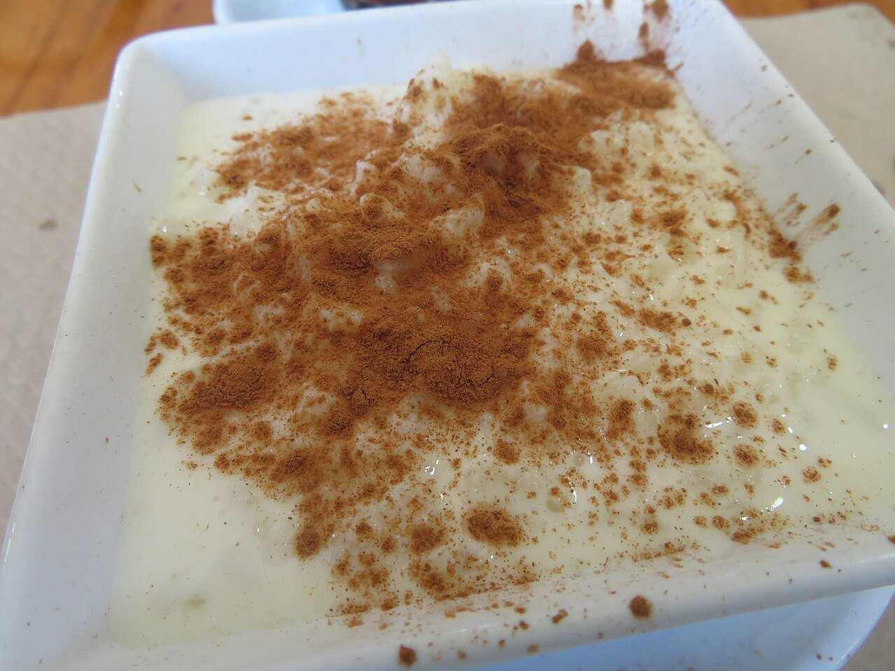

# Spanish rice pudding

*Photo: [Juan Emilio Prades Bel](https://commons.wikimedia.org/wiki/File:Arroz_con_leche_espolvoreado_con_canela_molida.jpg), [CC BY-SA 4.0](https://creativecommons.org/licenses/by-sa/4.0/), via Wikimedia Commons.*

🍚 Serves **6** · ⏱️ 1 hour · Difficulty: easy

*En español:* [Arroz con leche](arroz-con-leche.es.md)

## Ingredients

- 4 cups whole milk
- ½ cup short-grain rice (such as bomba or Arborio)
- ½ cup sugar
- 1 cinnamon stick
- Peel of 1 lemon (no white pith)
- Peel of ½ orange (optional)
- 1½ tablespoons butter (optional)
- Ground cinnamon, to serve

## Directions

1. **Infuse.** Heat the milk with the cinnamon stick and citrus peels. When it starts to boil, lower the heat.
2. **Add the rice.** Stir in the unrinsed rice and cook over very low heat for 40–45 minutes, stirring often so it doesn't stick.
3. **Sweeten.** When the rice is tender and the milk has thickened, remove the cinnamon and peels. Stir in the sugar (and butter) and cook 5 more minutes.
4. **Cool.** Spoon into bowls; it will thicken as it cools. Dust with ground cinnamon.

## Tips

- **For creaminess:** low heat and patience; the rice releases its starch slowly.
- **Sugar at the end:** added early, it slows down the rice softening.
- **Asturian style:** sprinkle with sugar and caramelize it with a kitchen torch.
