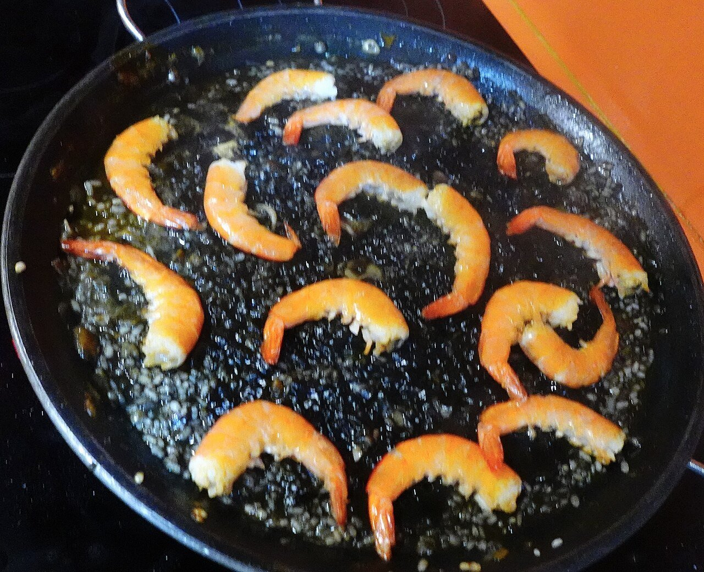

# Black rice with squid ink

*Photo: [JArribasphoto](https://commons.wikimedia.org/wiki/File:Arroz_negro_con_tinta_de_calamar_y_langostinos_en_paellera.jpg), [CC BY-SA 4.0](https://creativecommons.org/licenses/by-sa/4.0/), via Wikimedia Commons.*

🦑 Serves **4** · ⏱️ 50 minutes · Difficulty: medium

*En español:* [Arroz negro](arroz-negro.es.md)

## Ingredients

- 1½ cups bomba or other short-grain rice
- 14 oz cleaned cuttlefish or squid, diced
- 8 shrimp or prawns (optional)
- 1 onion
- 1 green bell pepper
- 3 garlic cloves
- 2 ripe tomatoes, grated
- 4 packets squid or cuttlefish ink (about ½ oz)
- 5 cups hot fish stock
- 1 teaspoon sweet smoked paprika (pimentón)
- 6 tablespoons extra-virgin olive oil
- Salt
- Aioli, to serve

## Directions

1. **Sear the seafood.** In a paella pan with the oil, sear the shrimp 1 minute per side and set aside. Add the squid and sauté 3–4 minutes.
2. **Sofrito.** Add the finely chopped onion, pepper and garlic and cook 10 minutes. Add the tomato and cook until its liquid evaporates. Stir in the paprika for a few seconds.
3. **Toast the rice.** Add the rice and stir 1–2 minutes to coat it.
4. **Stock and ink.** Dissolve the ink in a little stock and pour it in with the rest of the stock. Taste for salt. Cook 10 minutes over high heat and 8 more over medium, without stirring.
5. **Finish.** Lay the shrimp on top for the last few minutes. Rest 5 minutes covered with a towel and serve with aioli.

## Tips

- **Don't stir:** once the stock is in, leave the rice alone so it cooks evenly.
- **Socarrat:** turn up the heat for the last minute until you hear the bottom crackle.
- **Good stock matters:** it's half the flavor; homemade from shrimp heads and fish bones is best.
