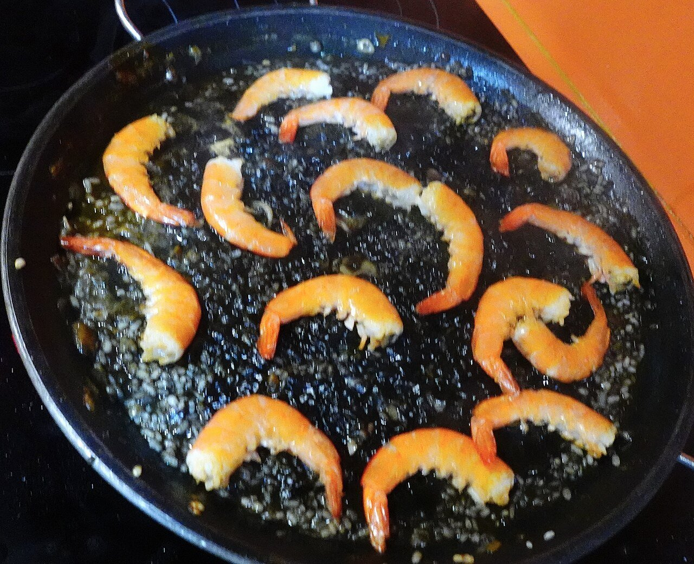

# Arroz negro

*Foto: [JArribasphoto](https://commons.wikimedia.org/wiki/File:Arroz_negro_con_tinta_de_calamar_y_langostinos_en_paellera.jpg), [CC BY-SA 4.0](https://creativecommons.org/licenses/by-sa/4.0/deed.es), vía Wikimedia Commons.*

🦑 Para **4 personas** · ⏱️ 50 minutos · Dificultad: media

*In English:* [Black rice with squid ink](arroz-negro.en.md)

## Ingredientes

- 320 g de arroz bomba o redondo
- 400 g de sepia o calamar limpio, en dados
- 8 gambas o langostinos (opcional)
- 1 cebolla
- 1 pimiento verde
- 3 dientes de ajo
- 2 tomates maduros rallados
- 4 sobres de tinta de calamar o sepia (unos 16 g)
- 1,2 litros de caldo de pescado caliente
- 1 cucharadita de pimentón dulce
- 6 cucharadas de aceite de oliva virgen extra
- Sal
- Alioli, para servir

## Preparación

1. **Marcar el marisco.** En una paellera con el aceite, dora las gambas 1 minuto por lado y resérvalas. Añade la sepia y saltéala 3–4 minutos.
2. **Sofrito.** Agrega la cebolla, el pimiento y el ajo muy picados y pocha 10 minutos. Añade el tomate y cocina hasta que pierda el agua. Echa el pimentón y remueve unos segundos.
3. **Nacarar el arroz.** Añade el arroz y remueve 1–2 minutos para que se impregne.
4. **Caldo y tinta.** Disuelve la tinta en un poco de caldo y viértela con el resto del caldo. Prueba de sal. Cuece 10 minutos a fuego fuerte y 8 más a fuego medio, sin remover.
5. **Terminar.** Coloca las gambas encima en los últimos minutos. Deja reposar 5 minutos tapado con un paño y sirve con alioli.

## Consejos

- **Sin remover:** una vez añadido el caldo, no toques el arroz; así se hace por igual.
- **Socarrat:** sube el fuego el último minuto hasta que oigas crepitar el fondo.
- **El caldo, bueno:** es la mitad del sabor; mejor casero con cabezas de gamba y morralla.
