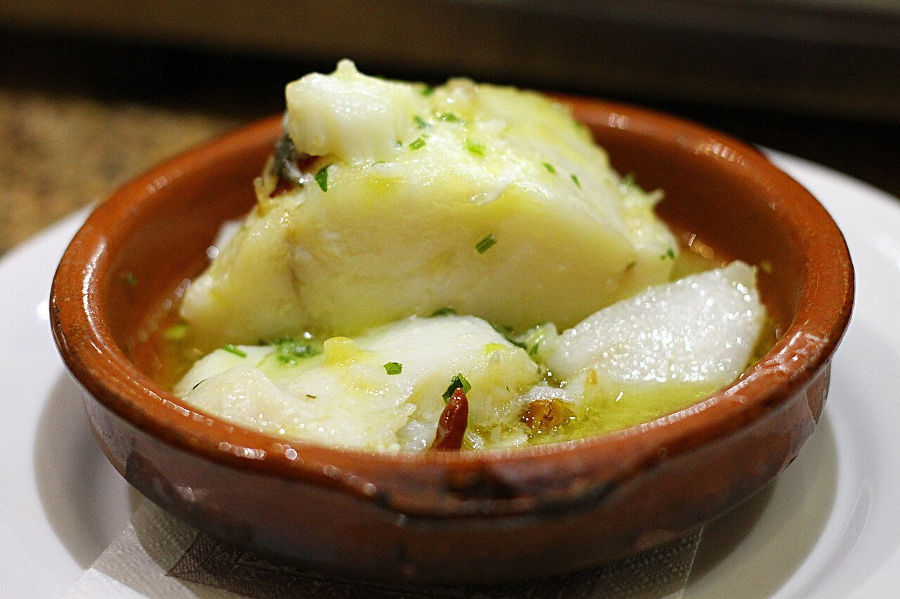

# Salt cod pil-pil

*Photo: [Jun](https://commons.wikimedia.org/wiki/File:Bacalao_a_pil_pil,_Bar_Lo_Gueno,_Malaga.jpg), [CC BY-SA 2.0](https://creativecommons.org/licenses/by-sa/2.0/), via Wikimedia Commons.*

🐟 Serves **4** · ⏱️ 40 minutes (+ 48 hours desalting) · Difficulty: hard

*En español:* [Bacalao al pil-pil](bacalao-al-pil-pil.es.md)

## Ingredients

- 4 skin-on salt cod loins (about 7 oz each)
- 1 cup mild extra-virgin olive oil (such as Arbequina)
- 5 garlic cloves, sliced
- 1 dried chili (cayenne)

## Directions

1. **Desalt.** Soak the cod in cold water, skin side up, in the fridge for 48 hours, changing the water every 8 hours. Pat completely dry.
2. **Brown the garlic.** In an earthenware or heavy pan, warm the oil over low heat and gently brown the garlic and sliced chili. Remove and set aside.
3. **Poach.** Let the oil cool to warm (about 140–160 °F) and add the loins skin side up. Poach over very low heat 5 minutes, flip and cook 3–4 more. They will release a whitish gelatin.
4. **Emulsify.** Move the cod to a plate. Pour the oil into a bowl and let it cool slightly. Return it to the pan a little at a time while swirling the pan (or whisking with a small strainer), until the gelatin and oil turn into a thick, pale yellow sauce.
5. **Serve.** Return the cod to the pan, warm it 1 minute in the sauce and top with the garlic and chili.

## Tips

- **Temperature:** if the oil is too hot, the sauce breaks. Warm, not hot, is the key.
- **Use a strainer:** swirling a mesh strainer in the oil helps it emulsify.
- **Good cod:** thick, skin-on loins release the most gelatin.
