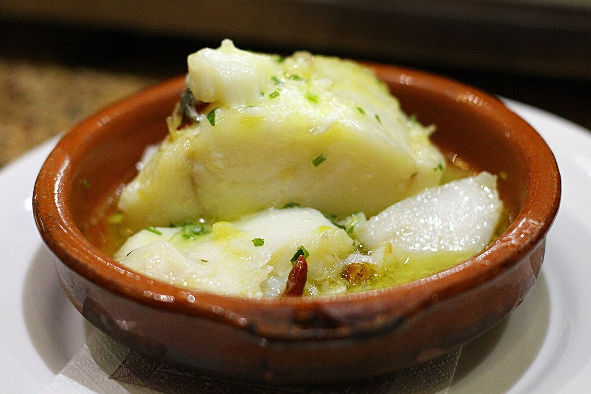

# Bacalao al pil-pil

*Foto: [Jun](https://commons.wikimedia.org/wiki/File:Bacalao_a_pil_pil,_Bar_Lo_Gueno,_Malaga.jpg), [CC BY-SA 2.0](https://creativecommons.org/licenses/by-sa/2.0/deed.es), vía Wikimedia Commons.*

🐟 Para **4 personas** · ⏱️ 40 minutos (+ 48 horas de desalado) · Dificultad: alta

*In English:* [Salt cod pil-pil](bacalao-al-pil-pil.en.md)

## Ingredientes

- 4 lomos de bacalao salado con piel (unos 200 g cada uno)
- 250 ml de aceite de oliva virgen extra (suave, tipo arbequina)
- 5 dientes de ajo en láminas
- 1 guindilla seca (cayena)

## Preparación

1. **Desalar.** Pon el bacalao en agua fría con la piel hacia arriba, en la nevera, 48 horas, cambiando el agua cada 8 horas. Sécalo muy bien con papel de cocina.
2. **Dorar el ajo.** En una cazuela de barro, calienta el aceite a fuego suave y dora el ajo y la guindilla en aros. Sácalos y resérvalos.
3. **Confitar.** Deja templar el aceite (unos 60–70 °C) y pon los lomos con la piel hacia arriba. Confítalos a fuego muy bajo 5 minutos, dales la vuelta y deja 3–4 minutos más. Irán soltando una gelatina blanquecina.
4. **Ligar.** Saca el bacalao a un plato. Retira el aceite a un bol y deja templar. Ve devolviéndolo a la cazuela poco a poco mientras mueves la cazuela en círculos (o bates con un colador), hasta que la gelatina y el aceite liguen en una salsa espesa y amarillenta.
5. **Servir.** Devuelve los lomos a la cazuela, caliéntalos 1 minuto en la salsa y decora con el ajo y la guindilla.

## Consejos

- **Temperatura:** si el aceite está demasiado caliente, el pil-pil se corta. Tibio es la clave.
- **Con colador:** mover un colador de varillas en círculos ayuda mucho a ligar.
- **El bacalao, de calidad:** el de lomo grueso y con piel suelta más gelatina.
