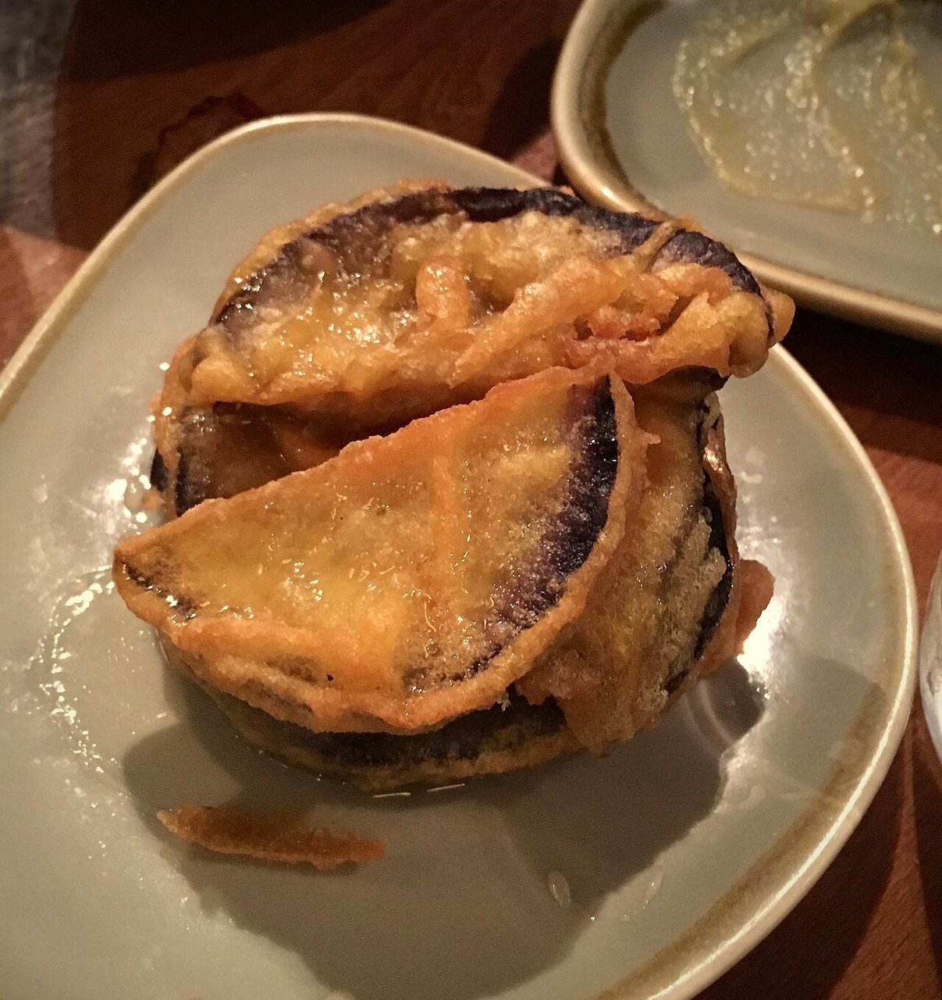

# Berenjenas con miel de caña

*Foto: [Timo Tijhof](https://commons.wikimedia.org/wiki/File:Berenjenas_con_Miel.jpg), [CC BY 4.0](https://creativecommons.org/licenses/by/4.0/deed.es), vía Wikimedia Commons.*

🍆 Para **4 personas** · ⏱️ 30 minutos (+ 1 hora de remojo) · Dificultad: fácil

*In English:* [Fried eggplant with cane honey](berenjenas-con-miel-de-cana.en.md)

## Ingredientes

- 2 berenjenas medianas
- 500 ml de leche (o agua con sal)
- 150 g de harina de trigo (o harina de freír)
- Aceite de oliva, para freír
- Miel de caña (melaza), al gusto
- Sal en escamas

## Preparación

1. **Cortar.** Lava las berenjenas y córtalas en bastones o rodajas finas de 1 cm, con piel.
2. **Remojar.** Sumérgelas en la leche (o agua con sal) 1 hora; así pierden el amargor y absorben menos aceite.
3. **Enharinar.** Escúrrelas sin secarlas del todo y pásalas por harina, sacudiendo el exceso.
4. **Freír.** Fríelas en tandas en abundante aceite muy caliente (180 °C) hasta que estén doradas y crujientes. Escúrrelas sobre papel de cocina.
5. **Servir.** Pon una pizca de sal en escamas y riega con un hilo de miel de caña justo antes de llevarlas a la mesa.

## Consejos

- **Crujientes:** fríe pocas cada vez para que el aceite no se enfríe.
- **Al momento:** la miel ablanda el rebozado, así que échala al final.
- **Sin miel de caña:** la miel de flores o el sirope de dátil también funcionan.
