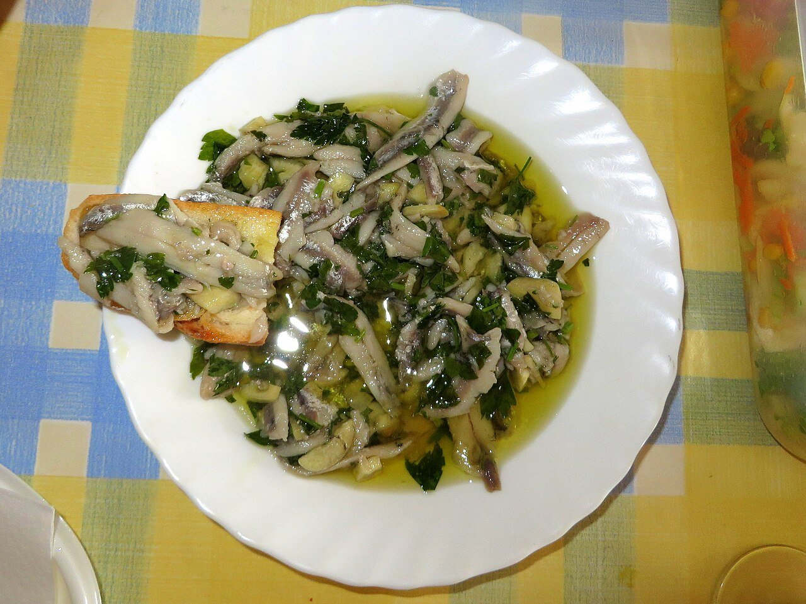

# Anchovies in vinegar

*Photo: [Avicentegil](https://commons.wikimedia.org/wiki/File:Boquerones_en_vinagre,_Murcia.jpg), [CC BY-SA 4.0](https://creativecommons.org/licenses/by-sa/4.0/), via Wikimedia Commons.*

🐟 Serves **4** · ⏱️ 30 minutes (+ 5 days freezing and 6 hours marinating) · Difficulty: easy

*En español:* [Boquerones en vinagre](boquerones-en-vinagre.es.md)

## Ingredients

- 1 lb fresh anchovies
- 1 cup white wine vinegar
- ⅓ cup water
- 1 tablespoon salt
- 3 garlic cloves, minced
- 1 bunch parsley, chopped
- Extra-virgin olive oil

## Directions

1. **Clean.** Remove the heads and guts, open the anchovies like a book and pull out the backbone. Split into two fillets if you like. Rinse in ice-cold water until no more blood comes out.
2. **Freeze.** For safety (anisakis parasites), freeze them at least 5 days at –4 °F. Thaw in the fridge.
3. **Marinate.** Mix the vinegar, water and salt. Cover the fillets with it and refrigerate 4–6 hours, until they turn white.
4. **Dress.** Drain and arrange on a platter. Top with the garlic, parsley and a generous drizzle of oil.

## Tips

- **Whiter fillets:** a few ice cubes in the rinsing water help draw out the blood.
- **Less tangy:** shorten the marinating time or add more water to the vinegar.
- **Keeps** 4–5 days in the fridge, covered in oil.
