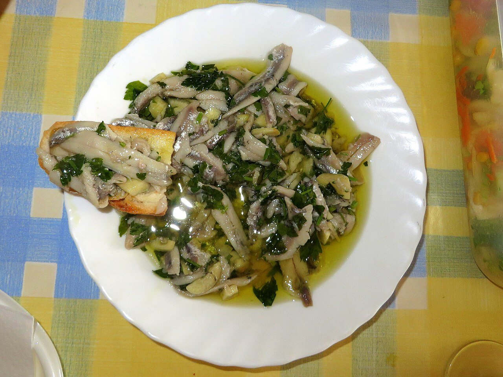

# Boquerones en vinagre

*Foto: [Avicentegil](https://commons.wikimedia.org/wiki/File:Boquerones_en_vinagre,_Murcia.jpg), [CC BY-SA 4.0](https://creativecommons.org/licenses/by-sa/4.0/deed.es), vía Wikimedia Commons.*

🐟 Para **4 personas** · ⏱️ 30 minutos (+ 5 días de congelación y 6 horas de marinado) · Dificultad: fácil

*In English:* [Anchovies in vinegar](boquerones-en-vinagre.en.md)

## Ingredientes

- 500 g de boquerones frescos
- 250 ml de vinagre de vino blanco
- 100 ml de agua
- 1 cucharada de sal
- 3 dientes de ajo picados
- 1 manojo de perejil picado
- Aceite de oliva virgen extra

## Preparación

1. **Limpiar.** Quita la cabeza y las tripas a los boquerones, ábrelos en libro y retira la espina central. Sepáralos en dos lomos si quieres. Lávalos en agua muy fría hasta que no suelten sangre.
2. **Congelar.** Por seguridad (anisakis), congélalos al menos 5 días a –20 °C. Descongélalos en la nevera.
3. **Marinar.** Mezcla el vinagre, el agua y la sal. Cubre los lomos con esta mezcla y déjalos en la nevera 4–6 horas, hasta que estén blancos.
4. **Aliñar.** Escúrrelos y colócalos en una fuente. Cúbrelos con el ajo, el perejil y un buen chorro de aceite.

## Consejos

- **Más blancos:** unos cubitos de hielo en el agua de lavado ayudan a sacar la sangre.
- **Menos ácidos:** reduce el tiempo de marinado o añade más agua al vinagre.
- **Se conservan** 4–5 días en la nevera, cubiertos de aceite.
