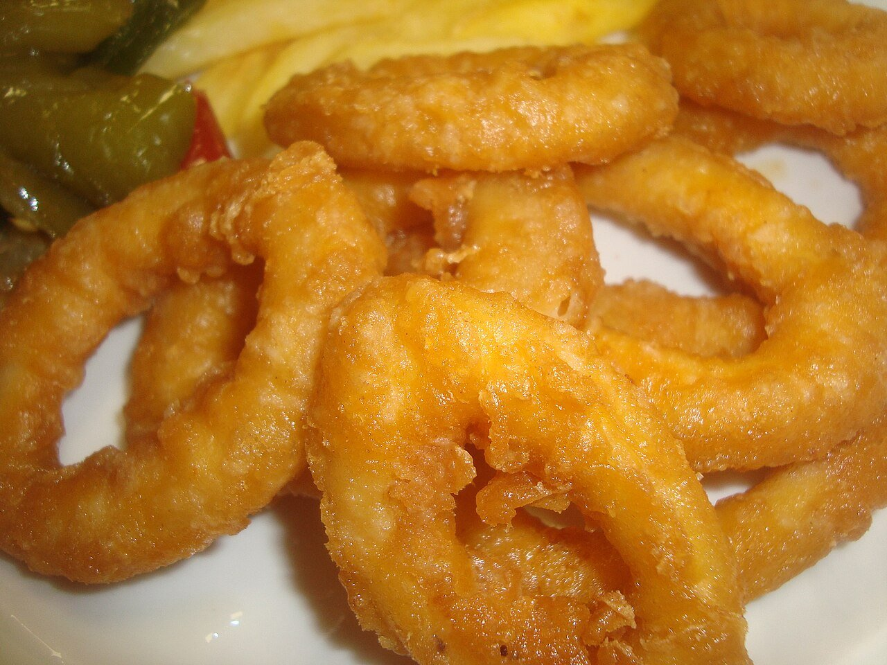

# Battered fried squid rings

*Photo: [Juan Emilio Prades Bel](https://commons.wikimedia.org/wiki/File:Calamares_a_la_romana._Fritura.jpg), [CC BY 4.0](https://creativecommons.org/licenses/by/4.0/), via Wikimedia Commons.*

🦑 Serves **4** · ⏱️ 30 minutes · Difficulty: easy

*En español:* [Calamares a la romana](calamares-a-la-romana.es.md)

## Ingredients

- 1⅓ lb cleaned squid tubes
- 1¼ cups all-purpose flour
- 1 egg
- ⅔ cup ice-cold sparkling water (or beer)
- 1 teaspoon baking powder (optional)
- Olive or sunflower oil, for frying
- Salt
- 1 lemon

## Directions

1. **Cut.** Slice the tubes into ½-inch rings. Pat them very dry and season with salt.
2. **Batter.** Whisk the flour with the baking powder, egg and sparkling water into a thick, smooth batter, like a custard.
3. **Fry.** Heat plenty of oil to 350 °F. Dip the rings in the batter, let the excess drip off and fry in batches 1–2 minutes, until golden.
4. **Drain and serve.** Drain on paper towels and serve right away with lemon wedges.

## Tips

- **Keep them tender:** fry briefly; squid turns rubbery if overcooked.
- **Extra crisp:** ice-cold sparkling water makes a lighter batter.
- **As a sandwich:** the Madrid classic, on a crusty roll with a little mayo or aioli.
