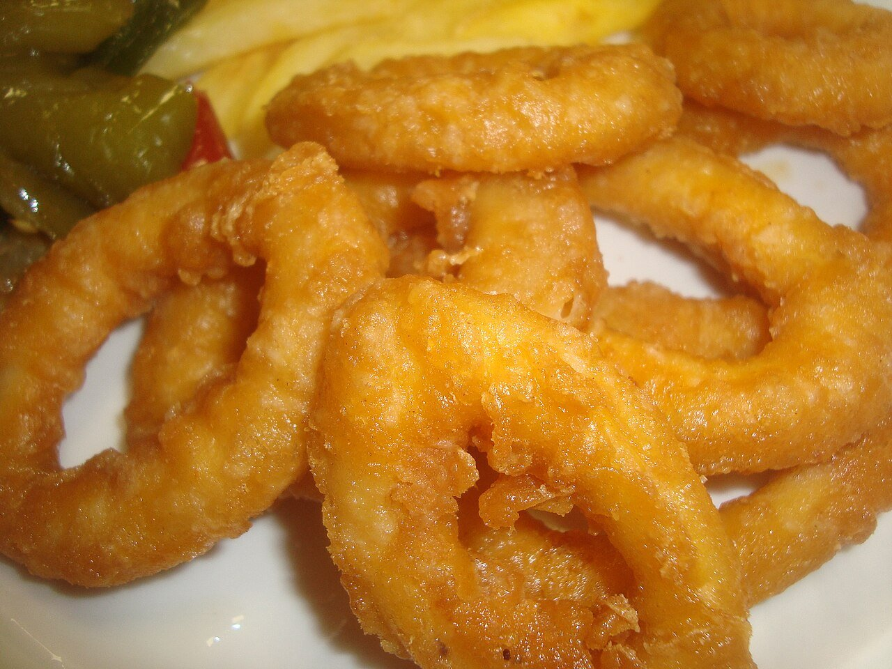

# Calamares a la romana

*Foto: [Juan Emilio Prades Bel](https://commons.wikimedia.org/wiki/File:Calamares_a_la_romana._Fritura.jpg), [CC BY 4.0](https://creativecommons.org/licenses/by/4.0/deed.es), vía Wikimedia Commons.*

🦑 Para **4 personas** · ⏱️ 30 minutos · Dificultad: fácil

*In English:* [Battered fried squid rings](calamares-a-la-romana.en.md)

## Ingredientes

- 600 g de calamares limpios (tubos)
- 150 g de harina de trigo
- 1 huevo
- 150 ml de agua con gas muy fría (o cerveza)
- 1 cucharadita de levadura química (opcional)
- Aceite de oliva o de girasol, para freír
- Sal
- 1 limón

## Preparación

1. **Cortar.** Corta los tubos en anillas de 1 cm. Sécalas muy bien con papel de cocina y sálalas.
2. **Rebozado.** Mezcla la harina con la levadura, el huevo y el agua con gas hasta obtener una masa espesa y sin grumos, como unas natillas.
3. **Freír.** Calienta abundante aceite a 180 °C. Pasa las anillas por la masa, escurre el exceso y fríelas en tandas 1–2 minutos, hasta que estén doradas.
4. **Escurrir y servir.** Sácalas a papel de cocina y sírvelas enseguida con gajos de limón.

## Consejos

- **Tiernos:** fríelos poco tiempo; el calamar se endurece si se pasa.
- **Más crujientes:** el agua con gas muy fría hace el rebozado más aireado.
- **En bocadillo:** el clásico de Madrid, con un poco de mayonesa o alioli.
