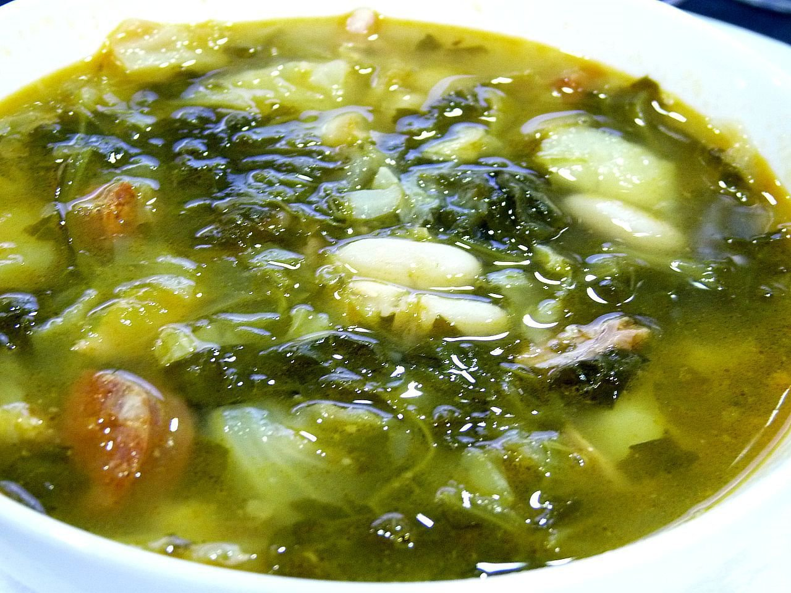

# Galician greens and bean soup

*Photo: [Juan Mejuto](https://commons.wikimedia.org/wiki/File:Caldo_gallego_-_juantiagues.jpg), [CC BY-SA 2.0](https://creativecommons.org/licenses/by-sa/2.0/), via Wikimedia Commons.*

🥬 Serves **6** · ⏱️ 2 hours 30 minutes (+ 12 hours soaking) · Difficulty: easy

*En español:* [Caldo gallego](caldo-gallego.es.md)

## Ingredients

- 1 cup (7 oz) dried white beans (navy or cannellini)
- 10 oz cured pork shoulder or smoked ham hock
- 1 ham bone
- 3½ oz pork fatback or salt pork (optional)
- 1 Spanish chorizo (optional)
- 1 lb turnip greens, collards or kale, cut into strips
- 4 medium potatoes
- 10 cups water
- Salt

## Directions

1. **Soak.** Soak the beans overnight. If the pork is salty, soak it in water too.
2. **The meat.** In a large stockpot, add the water, pork, ham bone and fatback. Bring to a boil, skim and simmer gently for 1 hour.
3. **The beans.** Add the drained beans and simmer 45 minutes more, until almost tender.
4. **Greens and potatoes.** Add the rinsed greens, the potatoes (peeled and broken into chunks, not sliced) and the chorizo. Cook 30 minutes more.
5. **Rest.** Taste for salt, remove the bone, cut the meat into pieces and return it to the pot. Let it rest 10 minutes before serving.

## Tips

- **Break, don't slice, the potatoes:** the rough edges release starch and thicken the broth.
- **No turnip greens?** Collards or kale work well.
- **Better reheated:** the flavor rounds out by the next day.
