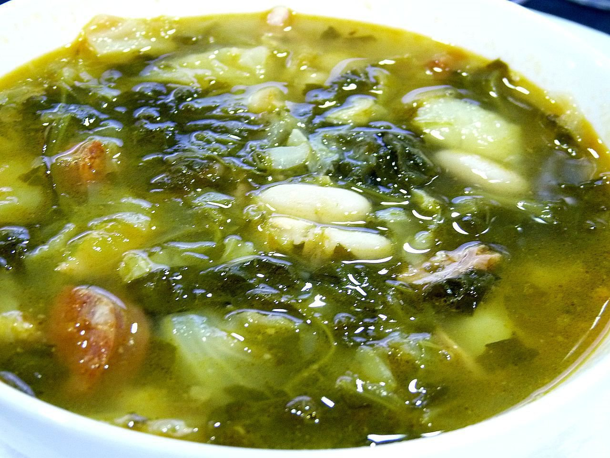

# Caldo gallego

*Foto: [Juan Mejuto](https://commons.wikimedia.org/wiki/File:Caldo_gallego_-_juantiagues.jpg), [CC BY-SA 2.0](https://creativecommons.org/licenses/by-sa/2.0/deed.es), vía Wikimedia Commons.*

🥬 Para **6 personas** · ⏱️ 2 horas 30 minutos (+ 12 horas de remojo) · Dificultad: fácil

*In English:* [Galician greens and bean soup](caldo-gallego.en.md)

## Ingredientes

- 200 g de alubias blancas secas
- 300 g de lacón o paleta de cerdo
- 1 hueso de jamón (o de rodilla de cerdo)
- 100 g de unto o tocino (opcional)
- 1 chorizo (opcional)
- 500 g de grelos o berza, en tiras
- 4 patatas medianas
- 2,5 litros de agua
- Sal

## Preparación

1. **Remojar.** Pon las alubias en remojo la noche anterior. Si el lacón está salado, desálalo también en agua.
2. **Las carnes.** En una olla grande, pon el agua con el lacón, el hueso y el unto. Lleva a ebullición, espuma y cuece a fuego suave 1 hora.
3. **Las alubias.** Añade las alubias escurridas y sigue cociendo 45 minutos más, hasta que estén casi tiernas.
4. **Verdura y patata.** Añade los grelos lavados, las patatas peladas y cascadas (rotas, no cortadas) y el chorizo. Cuece 30 minutos más.
5. **Reposar.** Prueba de sal, retira el hueso, trocea las carnes y devuélvelas a la olla. Deja reposar 10 minutos antes de servir.

## Consejos

- **Cascar las patatas:** al romperlas sueltan almidón y el caldo espesa un poco.
- **Grelos fuera de temporada:** usa nabizas, berza o col rizada.
- **Mejor recalentado:** al día siguiente el sabor es más redondo.
