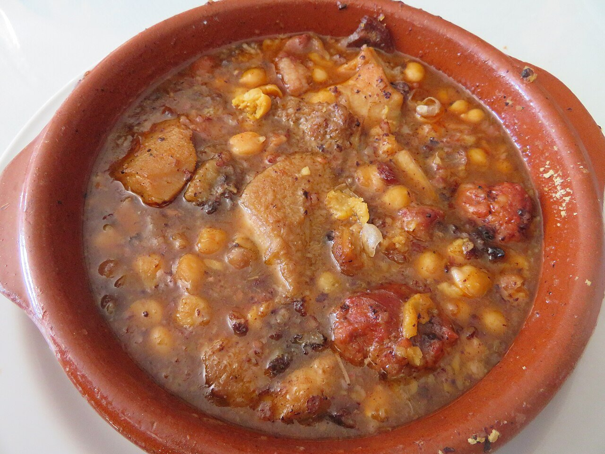

# Madrid-style tripe stew

*Photo: [Juan Emilio Prades Bel](https://commons.wikimedia.org/wiki/File:Callos_a_la_madrile%C3%B1a_con_garbanzos.jpg), [CC BY 4.0](https://creativecommons.org/licenses/by/4.0/), via Wikimedia Commons.*

🍲 Serves **6** · ⏱️ 4 hours · Difficulty: medium

*En español:* [Callos a la madrileña](callos-a-la-madrilena.es.md)

## Ingredients

- 2¼ lb cleaned beef tripe
- 1 calf's foot (or 2 pig's trotters)
- 2 Spanish chorizos
- 1 Spanish onion blood sausage (morcilla)
- 3½ oz diced serrano ham
- 1 onion, 1 head of garlic, 1 bay leaf and 6 peppercorns, for boiling
- 1 chopped onion and 2 garlic cloves, for the sofrito
- 1 tablespoon sweet smoked paprika (pimentón)
- 1 dried chili (optional)
- 1 tablespoon all-purpose flour
- Vinegar and salt

## Directions

1. **Clean.** Scrub the tripe and foot with water, salt and vinegar. Blanch 5 minutes in boiling water and discard that water.
2. **Boil.** Cover with fresh water and add the onion, head of garlic, bay leaf and peppercorns. Simmer 3 hours (or 45 minutes in a pressure cooker) until very tender. Add the chorizo and morcilla for the last 20 minutes.
3. **Cut.** Remove the meat, bone the foot and cut everything into bite-size pieces. Slice the sausages. Strain and save the broth.
4. **Sofrito.** In a Dutch oven, sauté the onion, garlic and ham. Stir in the flour, then the paprika and chili, and immediately add a couple of ladles of broth.
5. **Stew.** Add all the meat and enough broth to cover. Simmer 30 minutes more, until the sauce is thick and sticky.

## Tips

- **Best the next day:** tripe improves a lot after resting overnight.
- **Don't burn the paprika:** add it off the heat or with broth ready.
- **With chickpeas:** stir in some cooked chickpeas at the end for a heartier dish.
