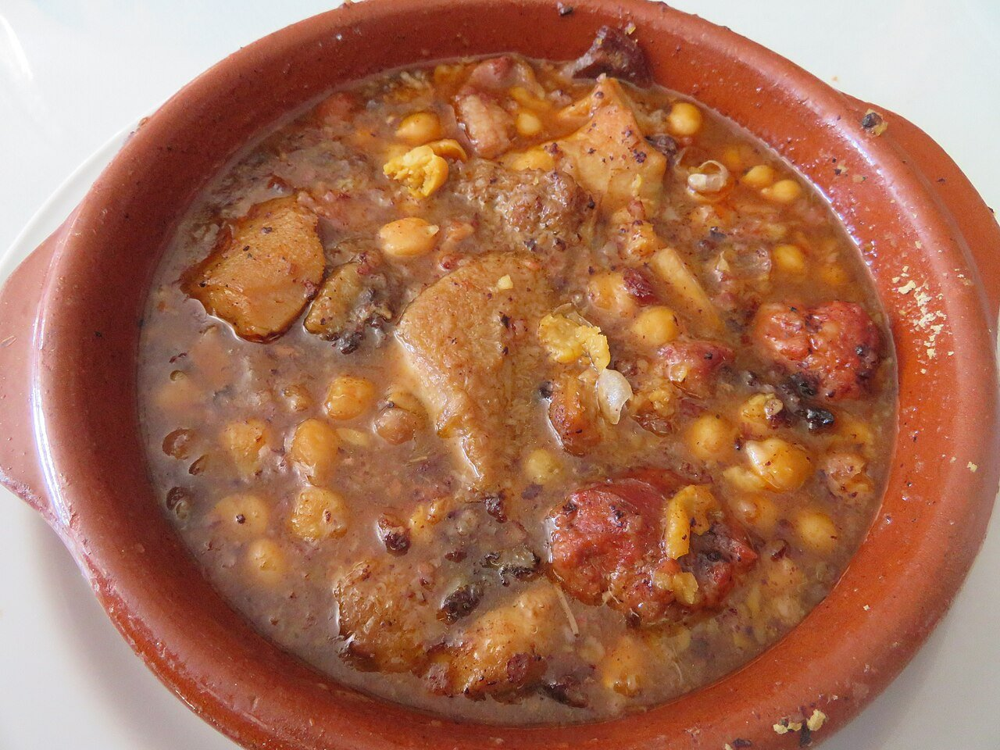

# Callos a la madrileña

*Foto: [Juan Emilio Prades Bel](https://commons.wikimedia.org/wiki/File:Callos_a_la_madrile%C3%B1a_con_garbanzos.jpg), [CC BY 4.0](https://creativecommons.org/licenses/by/4.0/deed.es), vía Wikimedia Commons.*

🍲 Para **6 personas** · ⏱️ 4 horas · Dificultad: media

*In English:* [Madrid-style tripe stew](callos-a-la-madrilena.en.md)

## Ingredientes

- 1 kg de callos de ternera limpios
- 1 pata o morro de ternera (o 2 manitas de cerdo)
- 2 chorizos
- 1 morcilla de cebolla
- 100 g de jamón serrano en taquitos
- 1 cebolla, 1 cabeza de ajos, 1 hoja de laurel y 6 granos de pimienta, para cocer
- 1 cebolla picada y 2 dientes de ajo, para el sofrito
- 1 cucharada de pimentón dulce
- 1 guindilla (opcional)
- 1 cucharada de harina
- Vinagre y sal

## Preparación

1. **Limpiar.** Lava los callos y la pata con agua, sal y vinagre, frotando bien. Escáldalos 5 minutos en agua hirviendo y desecha esa agua.
2. **Cocer.** Cúbrelos de agua limpia con la cebolla, la cabeza de ajos, el laurel y la pimienta. Cuece a fuego suave 3 horas (o 45 minutos en olla rápida), hasta que estén muy tiernos. Añade el chorizo y la morcilla los últimos 20 minutos.
3. **Trocear.** Saca las carnes, deshuesa la pata y córtalo todo en trozos. Corta el chorizo y la morcilla en rodajas. Cuela y reserva el caldo.
4. **Sofrito.** En una cazuela, sofríe la cebolla, el ajo y el jamón. Añade la harina, luego el pimentón y la guindilla, y enseguida un par de cucharones de caldo.
5. **Guisar.** Incorpora todas las carnes y caldo hasta cubrir. Cuece 30 minutos más, hasta que la salsa quede espesa y gelatinosa.

## Consejos

- **Mejor al día siguiente:** los callos ganan mucho tras reposar una noche.
- **El pimentón, sin quemar:** échalo fuera del fuego o con caldo a mano.
- **Con garbanzos:** añade unos garbanzos cocidos al final para hacerlos más contundentes.
