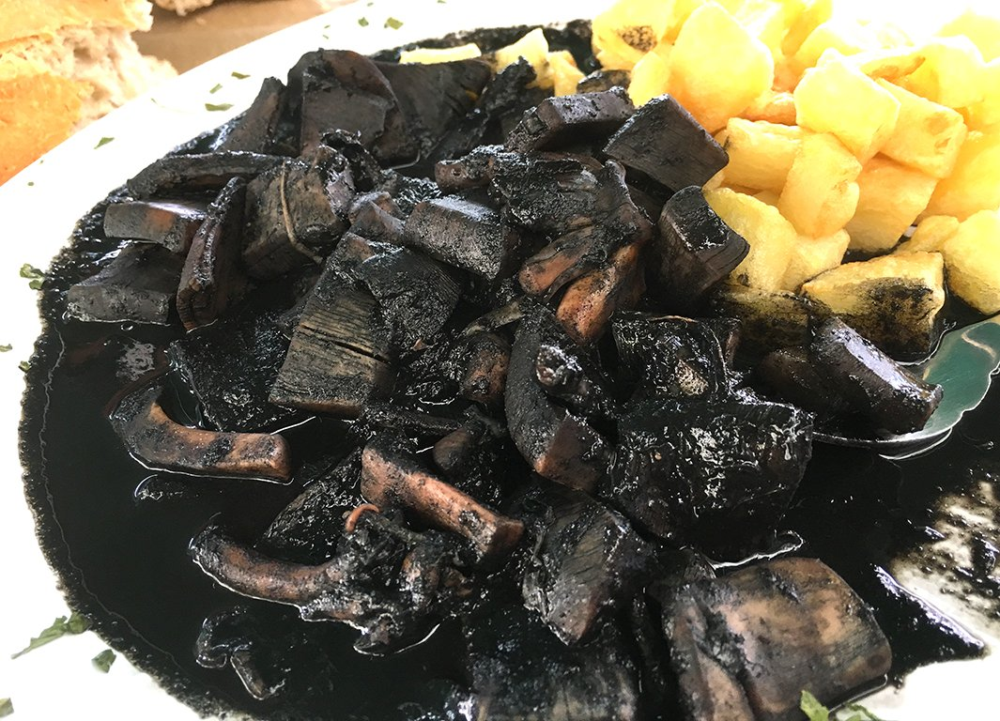

# Baby squid in ink sauce

*Photo: [Amasuela - Luis Lafuente Agudín](https://commons.wikimedia.org/wiki/File:Calamares_en_su_tinta_con_patatas.jpg), [CC BY-SA 4.0](https://creativecommons.org/licenses/by-sa/4.0/), via Wikimedia Commons.*

🦑 Serves **4** · ⏱️ 1 hour 15 minutes · Difficulty: medium

*En español:* [Chipirones en su tinta](chipirones-en-su-tinta.es.md)

## Ingredients

- 2¼ lb baby squid
- 2 large onions
- 1 green bell pepper
- 2 garlic cloves
- 1 ripe tomato
- ½ cup dry white wine
- 4 packets squid ink (or the squid's own ink sacs)
- ¾ cup fish stock
- 5 tablespoons olive oil
- Salt

## Directions

1. **Clean.** Pull the tentacles from the bodies, remove the quill and guts, and save the ink sacs. Chop the fins and tentacles and stuff them into the bodies. Close with a toothpick.
2. **Sear.** Brown the squid in a Dutch oven with oil, 1 minute per side, and set aside.
3. **Sauce.** In the same oil, gently cook the chopped onions, pepper and garlic for about 20 minutes. Add the tomato and cook 5 minutes more.
4. **Ink.** Pour in the wine and let it reduce. Dissolve the ink in the stock, add it and simmer 5 minutes. Blend the sauce until smooth.
5. **Simmer.** Return the squid to the sauce and simmer, covered, over low heat for 25–30 minutes, until tender. Serve with white rice.

## Tips

- **Cook the onion slowly:** its sweetness balances the ink.
- **Keep it tender:** low heat; a hard boil makes squid shrink and toughen.
- **Even better the next day.**
