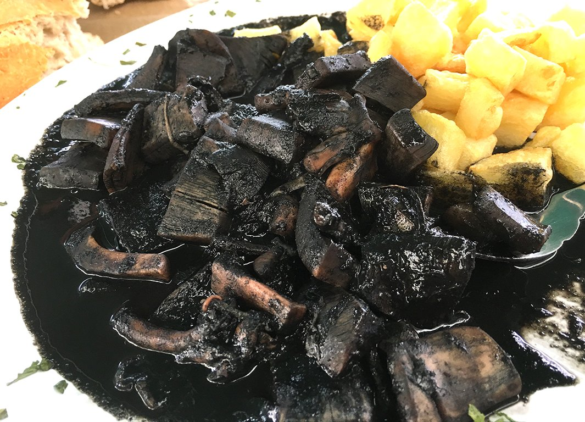

# Chipirones en su tinta

*Foto: [Amasuela - Luis Lafuente Agudín](https://commons.wikimedia.org/wiki/File:Calamares_en_su_tinta_con_patatas.jpg), [CC BY-SA 4.0](https://creativecommons.org/licenses/by-sa/4.0/deed.es), vía Wikimedia Commons.*

🦑 Para **4 personas** · ⏱️ 1 hora 15 minutos · Dificultad: media

*In English:* [Baby squid in ink sauce](chipirones-en-su-tinta.en.md)

## Ingredientes

- 1 kg de chipirones o calamares pequeños
- 2 cebollas grandes
- 1 pimiento verde
- 2 dientes de ajo
- 1 tomate maduro
- 100 ml de vino blanco
- 4 sobres de tinta de calamar (o la de los propios chipirones)
- 200 ml de caldo de pescado
- 5 cucharadas de aceite de oliva
- Sal

## Preparación

1. **Limpiar.** Separa los tentáculos del cuerpo, saca la pluma y las tripas, y guarda las bolsitas de tinta. Pica las aletas y los tentáculos y rellena con ellos los cuerpos. Ciérralos con un palillo.
2. **Marcar.** Dora los chipirones en una cazuela con aceite, 1 minuto por lado, y resérvalos.
3. **La salsa.** En ese aceite, pocha la cebolla, el pimiento y el ajo picados a fuego suave unos 20 minutos. Añade el tomate y cocina 5 minutos más.
4. **La tinta.** Vierte el vino y deja reducir. Disuelve la tinta en el caldo, añádela y cuece 5 minutos. Tritura la salsa hasta que quede fina.
5. **Guisar.** Mete los chipirones en la salsa y cuécelos a fuego suave, tapados, 25–30 minutos, hasta que estén tiernos. Sirve con arroz blanco.

## Consejos

- **La cebolla, bien pochada:** da el dulzor que equilibra la tinta.
- **Tiernos:** fuego suave; si hierven fuerte, se encogen.
- **Mejor reposados:** de un día para otro están aún más ricos.
