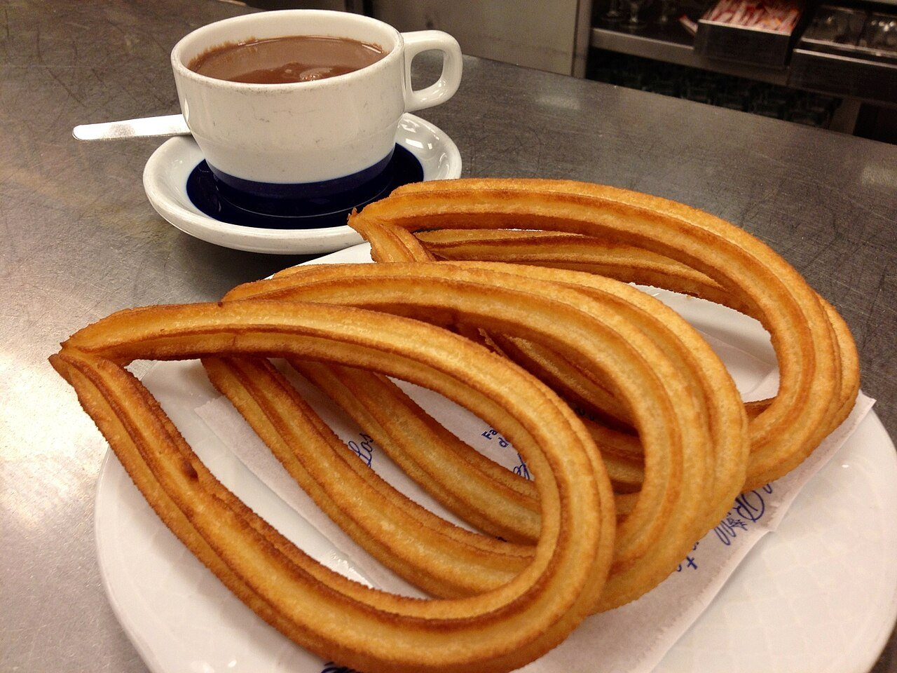

# Churros with thick hot chocolate

*Photo: [LWY](https://commons.wikimedia.org/wiki/File:Chocolate_con_churros_de_lazo.jpg), [CC BY 2.0](https://creativecommons.org/licenses/by/2.0/), via Wikimedia Commons.*

🍫 Serves **4** · ⏱️ 40 minutes · Difficulty: medium

*En español:* [Churros con chocolate](churros-con-chocolate.es.md)

## Ingredients

**For the churros**

- 1 cup water
- 2 cups all-purpose flour
- 1 pinch salt
- Sunflower or vegetable oil, for frying
- Sugar, for sprinkling (optional)

**For the chocolate**

- 2 cups whole milk
- 5 oz dark chocolate (50–70%), chopped
- 2 tablespoons sugar
- 1 heaping tablespoon cornstarch

## Directions

1. **Dough.** Bring the water and salt to a boil. Off the heat, add the flour all at once and stir with a wooden spoon until it forms a smooth ball. Let it cool 5 minutes.
2. **Shape.** Load the dough into a churro maker or a piping bag with a large star tip.
3. **Fry.** Heat the oil to 350 °F. Pipe 5-inch strips straight into the oil, snipping them off with scissors. Fry 2–3 minutes, turning, until golden. Drain.
4. **Chocolate.** Dissolve the cornstarch in a little cold milk. Heat the rest of the milk with the chocolate and sugar, stirring until melted. Add the cornstarch mixture and cook 2–3 minutes, stirring constantly, until thick.
5. **Serve.** Sprinkle the churros with sugar and serve hot with cups of chocolate for dipping.

## Tips

- **No splattering:** the dough must have no air pockets; pack it firmly.
- **For crispness:** keep the oil hot and fry in small batches.
- **Thicker chocolate:** add a little more cornstarch.
