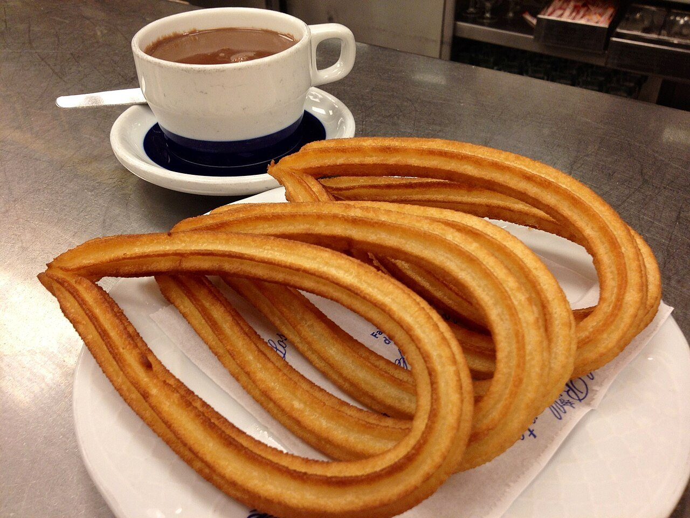

# Churros con chocolate

*Foto: [LWY](https://commons.wikimedia.org/wiki/File:Chocolate_con_churros_de_lazo.jpg), [CC BY 2.0](https://creativecommons.org/licenses/by/2.0/deed.es), vía Wikimedia Commons.*

🍫 Para **4 personas** · ⏱️ 40 minutos · Dificultad: media

*In English:* [Churros with thick hot chocolate](churros-con-chocolate.en.md)

## Ingredientes

**Para los churros**

- 250 ml de agua
- 250 g de harina de trigo
- 1 pizca de sal
- Aceite de girasol, para freír
- Azúcar, para espolvorear (opcional)

**Para el chocolate**

- 500 ml de leche entera
- 150 g de chocolate negro para fundir (50–70 %)
- 2 cucharadas de azúcar
- 1 cucharada colmada de maicena

## Preparación

1. **La masa.** Hierve el agua con la sal. Fuera del fuego, echa la harina de golpe y remueve con una cuchara de madera hasta formar una bola lisa sin grumos. Deja templar 5 minutos.
2. **Formar.** Mete la masa en una churrera o una manga pastelera con boquilla de estrella grande.
3. **Freír.** Calienta el aceite a 180 °C. Haz tiras de unos 12 cm directamente sobre el aceite, cortándolas con tijeras. Fríelas 2–3 minutos, dándoles la vuelta, hasta que estén doradas. Escúrrelas.
4. **El chocolate.** Disuelve la maicena en un poco de leche fría. Calienta el resto con el chocolate troceado y el azúcar, removiendo hasta que se funda. Añade la maicena y cuece 2–3 minutos, sin dejar de remover, hasta que espese.
5. **Servir.** Espolvorea los churros con azúcar y sírvelos calientes con el chocolate en tazas.

## Consejos

- **Sin explosiones:** la masa no debe tener aire; apriétala bien en la churrera.
- **Crujientes:** aceite bien caliente y tandas pequeñas.
- **Chocolate espeso:** si lo quieres más denso, añade un poco más de maicena.
