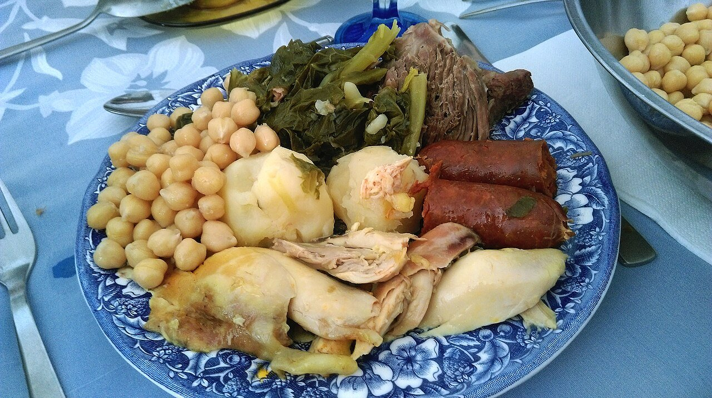

# Madrid-style chickpea and meat stew

*Photo: [Rubendene](https://commons.wikimedia.org/wiki/File:Cocido.jpg), [CC BY-SA 4.0](https://creativecommons.org/licenses/by-sa/4.0/), via Wikimedia Commons.*

🍲 Serves **6** · ⏱️ 4 hours (+ 12 hours soaking) · Difficulty: medium

*En español:* [Cocido madrileño](cocido-madrileno.es.md)

## Ingredients

- 2 cups (14 oz) dried chickpeas
- 1 lb beef shank
- ¼ stewing hen or 2 chicken thighs
- 5 oz salt pork or pork belly
- 1 ham end and 2 beef marrow bones
- 2 Spanish chorizos and 1 onion morcilla (blood sausage)
- 4 medium potatoes
- 3 carrots
- ½ green cabbage
- 1 garlic clove
- 5 oz thin noodles (fideos or angel hair, broken)
- Salt

## Directions

1. **Soak.** Soak the chickpeas overnight in warm salted water.
2. **The meat.** In a large stockpot, cover the beef, chicken, salt pork, ham and bones with cold water. Bring to a boil and skim well.
3. **Chickpeas.** Add the drained chickpeas (in a mesh bag, if you have one) once the water boils. Simmer very gently for about 3 hours, keeping a light bubble. Top up with hot water if needed, never cold.
4. **Vegetables.** For the last 30 minutes, add the peeled potatoes and carrots. Cook the chorizo and morcilla separately, and the cabbage too, then sauté the cabbage with garlic.
5. **Three courses.** Strain the broth and cook the noodles in it for the **soup** (first course). Then serve the **chickpeas and vegetables** (second) and finally the **meats** (third).

## Tips

- **Keep the chickpeas whole:** add them to boiling water and never shock them with cold water.
- **On the side:** tomato sauce, pickled guindilla peppers and scallions.
- **Leftovers:** turn them into croquettes or "ropa vieja" (sautéed shredded meat).
