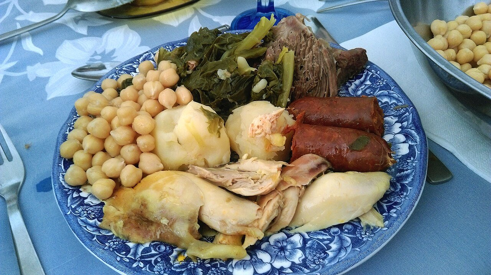

# Cocido madrileño

*Foto: [Rubendene](https://commons.wikimedia.org/wiki/File:Cocido.jpg), [CC BY-SA 4.0](https://creativecommons.org/licenses/by-sa/4.0/deed.es), vía Wikimedia Commons.*

🍲 Para **6 personas** · ⏱️ 4 horas (+ 12 horas de remojo) · Dificultad: media

*In English:* [Madrid-style chickpea and meat stew](cocido-madrileno.en.md)

## Ingredientes

- 400 g de garbanzos secos
- 500 g de morcillo de ternera
- ¼ de gallina o 2 muslos de pollo
- 150 g de tocino ibérico
- 1 punta de jamón y 2 huesos de caña (de ternera)
- 2 chorizos y 1 morcilla de cebolla
- 4 patatas medianas
- 3 zanahorias
- ½ repollo
- 1 diente de ajo
- 150 g de fideos finos
- Sal

## Preparación

1. **Remojar.** Deja los garbanzos en agua templada con sal la noche anterior.
2. **Las carnes.** En una olla grande, cubre de agua fría el morcillo, la gallina, el tocino, el jamón y los huesos. Lleva a ebullición y espuma bien.
3. **Los garbanzos.** Añade los garbanzos escurridos (dentro de una red, si tienes) cuando el agua hierva. Cuece a fuego muy suave unas 3 horas, sin que deje de borbotear. Añade agua caliente si hace falta, nunca fría.
4. **Verduras.** Los últimos 30 minutos, añade las patatas y las zanahorias peladas. Cuece aparte el chorizo y la morcilla, y también el repollo, que luego rehogarás con ajo.
5. **Los tres vuelcos.** Cuela el caldo y cuece en él los fideos para la **sopa** (primer vuelco). Sirve después los **garbanzos con las verduras** (segundo) y, por último, **las carnes** (tercero).

## Consejos

- **Garbanzos enteros:** que el agua hierva cuando los echas y no la cortes con agua fría.
- **Para acompañar:** salsa de tomate, guindillas en vinagre y cebolleta.
- **Con lo que sobre:** croquetas o ropa vieja.
