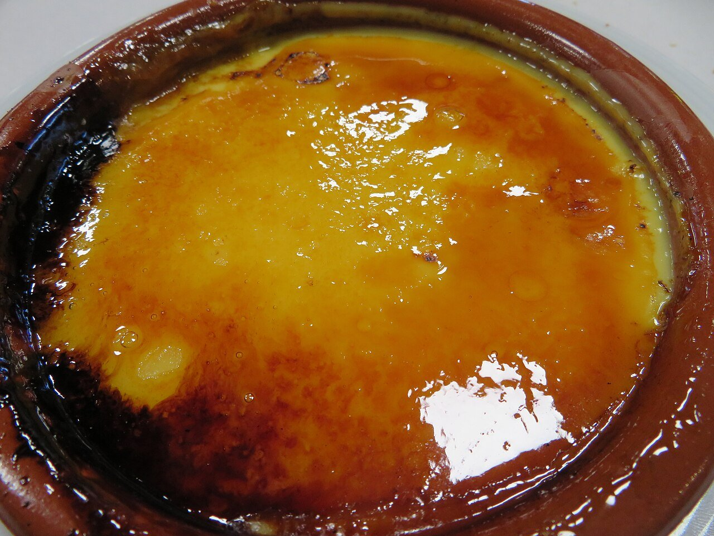

# Catalan custard with burnt sugar

*Photo: [Juan Emilio Prades Bel](https://commons.wikimedia.org/wiki/File:Crema_catalana._Postre.jpg), [CC BY 4.0](https://creativecommons.org/licenses/by/4.0/), via Wikimedia Commons.*

🍮 Serves **6** · ⏱️ 30 minutes (+ 3 hours chilling) · Difficulty: medium

*En español:* [Crema catalana](crema-catalana.es.md)

## Ingredients

- 4 cups whole milk
- 6 egg yolks
- ¾ cup sugar, plus more for caramelizing
- ⅓ cup cornstarch
- Peel of 1 lemon
- 1 cinnamon stick

## Directions

1. **Infuse.** Heat 3 cups of the milk with the lemon peel and cinnamon. When it boils, turn off the heat, cover and let steep 10 minutes.
2. **Mix.** In a bowl, whisk the yolks with the sugar. Add the cornstarch dissolved in the remaining cold milk.
3. **Thicken.** Strain the hot milk and slowly pour it over the yolks, whisking. Return everything to the pan and cook over low heat, stirring constantly, until thick, without letting it boil.
4. **Chill.** Pour into shallow ramekins, let cool and refrigerate at least 3 hours.
5. **Caramelize.** Just before serving, sprinkle each with a thin layer of sugar and torch it until caramelized.

## Tips

- **No lumps:** stir constantly over low heat.
- **Caramelize at the last minute:** done too early, the crust softens.
- **A Saint Joseph's Day treat:** in Catalonia it's traditionally eaten on March 19.
