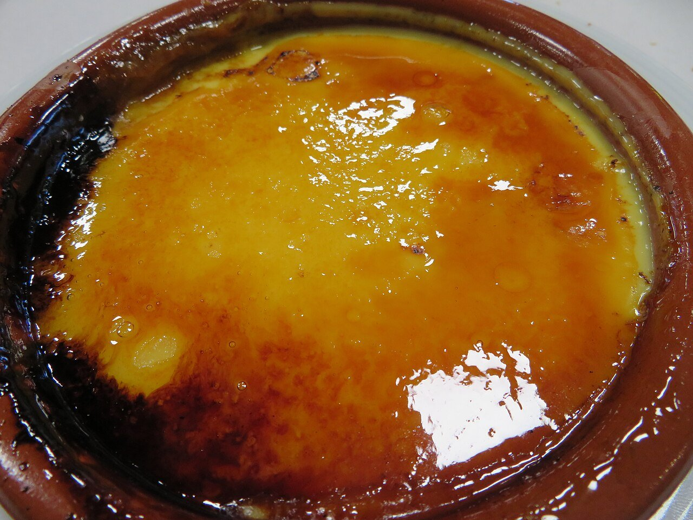

# Crema catalana

*Foto: [Juan Emilio Prades Bel](https://commons.wikimedia.org/wiki/File:Crema_catalana._Postre.jpg), [CC BY 4.0](https://creativecommons.org/licenses/by/4.0/deed.es), vía Wikimedia Commons.*

🍮 Para **6 personas** · ⏱️ 30 minutos (+ 3 horas de frío) · Dificultad: media

*In English:* [Catalan custard with burnt sugar](crema-catalana.en.md)

## Ingredientes

- 1 litro de leche entera
- 6 yemas de huevo
- 150 g de azúcar, y más para quemar
- 40 g de maicena
- La piel de 1 limón
- 1 rama de canela

## Preparación

1. **Infusionar.** Calienta 750 ml de la leche con la piel de limón y la canela. Cuando hierva, apaga el fuego, tapa y deja 10 minutos.
2. **Mezclar.** En un bol, bate las yemas con el azúcar. Añade la maicena disuelta en el resto de leche fría.
3. **Espesar.** Cuela la leche caliente y viértela poco a poco sobre las yemas, batiendo. Devuélvelo todo al cazo y cuece a fuego suave, sin parar de remover, hasta que espese, sin que llegue a hervir.
4. **Enfriar.** Reparte la crema en cazuelitas de barro, deja templar y mete en la nevera al menos 3 horas.
5. **Quemar.** Justo antes de servir, cubre cada una con una capa fina de azúcar y quémala con un soplete o una pala de hierro al rojo hasta que caramelice.

## Consejos

- **Sin grumos:** remueve siempre en el mismo sentido y con fuego suave.
- **El azúcar, en el último momento:** si se quema antes, el caramelo se ablanda.
- **Es la de San José:** en Cataluña se toma tradicionalmente el 19 de marzo.
