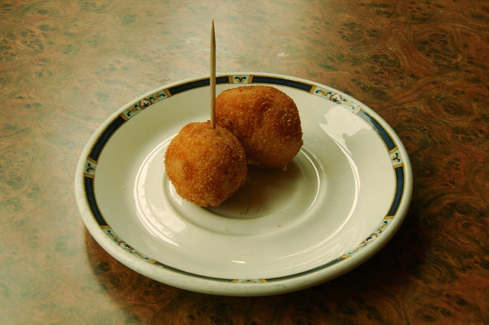

# Croquetas de jamón

*Foto: [Tamorlan](https://commons.wikimedia.org/wiki/File:Croquetas-Jam%C3%B3n-Riofr%C3%ADo.jpg), [CC BY 3.0](https://creativecommons.org/licenses/by/3.0/deed.es), vía Wikimedia Commons.*

🧆 Para **unas 30 croquetas** · ⏱️ 1 hora (+ 4 horas de reposo) · Dificultad: media

*In English:* [Serrano ham croquettes](croquetas-de-jamon.en.md)

## Ingredientes

- 150 g de jamón serrano en taquitos muy pequeños
- 1 litro de leche entera
- 100 g de mantequilla
- 2 cucharadas de aceite de oliva
- 100 g de harina de trigo
- ½ cebolla muy picada (opcional)
- Nuez moscada, sal y pimienta
- 2 huevos batidos y pan rallado, para rebozar
- Aceite de oliva o girasol, para freír

## Preparación

1. **Rehogar.** En una sartén amplia, derrite la mantequilla con el aceite y pocha la cebolla 5 minutos. Añade el jamón y rehoga 1 minuto.
2. **Bechamel.** Añade la harina y tuéstala 2–3 minutos removiendo. Vierte la leche caliente poco a poco, sin dejar de remover con varillas.
3. **Espesar.** Cuece a fuego suave 15–20 minutos, removiendo, hasta que la masa se despegue de la sartén. Ajusta de sal (con cuidado, el jamón sala), pimienta y nuez moscada.
4. **Reposar.** Pasa la masa a una fuente, cúbrela con film a piel y déjala en la nevera al menos 4 horas.
5. **Formar y rebozar.** Coge porciones con dos cucharas, dales forma alargada, pásalas por huevo y luego por pan rallado.
6. **Freír.** Fríelas en tandas en aceite caliente (180 °C) hasta que estén doradas. Escúrrelas en papel de cocina.

## Consejos

- **Cremosas:** la masa debe quedar blanda; poca harina y bastante cocción.
- **Que no se abran:** aceite muy caliente, poca cantidad por tanda y la masa bien fría.
- **Se congelan** ya rebozadas; fríelas directamente congeladas.
