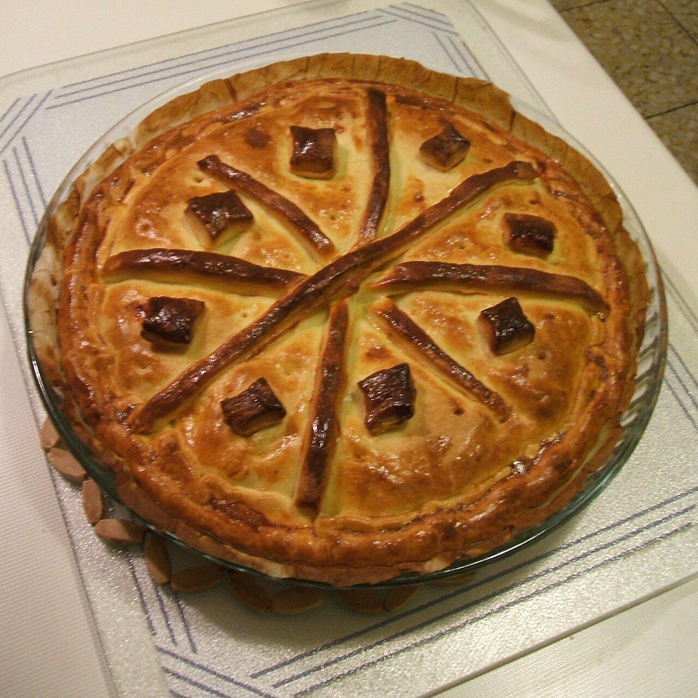

# Galician tuna pie

*Photo: [Yoolian](https://commons.wikimedia.org/wiki/File:Empanada_gallega_de_caballa_(1944px).jpg), [CC0](https://creativecommons.org/publicdomain/zero/1.0/), via Wikimedia Commons.*

🥧 Serves **8** · ⏱️ 2 hours (including rising) · Difficulty: medium

*En español:* [Empanada gallega](empanada-gallega.es.md)

## Ingredients

**For the dough**

- 4 cups all-purpose flour
- ⅔ cup warm water
- ⅓ cup dry white wine
- ⅓ cup oil from the filling
- 2¼ teaspoons (1 packet) active dry yeast
- 1 teaspoon salt
- 1 beaten egg, for brushing

**For the filling**

- 3 large onions
- 2 red bell peppers (or 1 red and 1 green)
- 2 garlic cloves
- 1 teaspoon sweet smoked paprika (pimentón)
- 14 oz oil-packed tuna, drained
- 2 hard-boiled eggs (optional)
- ⅔ cup olive oil
- Salt

## Directions

1. **Filling.** Slowly cook the sliced onions and peppers with the garlic in the oil over low heat, about 40 minutes. Add the paprika and salt and remove from the heat. Drain and **save the oil** for the dough.
2. **Dough.** Dissolve the yeast in the water. Mix the flour with the salt, wine, reserved oil and yeast water. Knead 5–10 minutes until smooth. Cover and let rise 1 hour.
3. **Assemble.** Divide the dough in two (one piece a bit bigger). Roll the larger one very thin and line a baking sheet. Spread the cooled filling, flaked tuna and chopped egg on top.
4. **Seal.** Cover with the second sheet, roll the edges inward to seal and cut a hole in the center for steam. Brush with beaten egg.
5. **Bake.** Bake at 350 °F for 35–40 minutes, until golden. Let it cool a bit before slicing.

## Tips

- **Thin dough:** a Galician empanada is all about the filling.
- **Cool, drained filling:** otherwise the bottom crust stays raw.
- **Other fillings:** scallops, salt cod with raisins, sardines or marinated pork.
