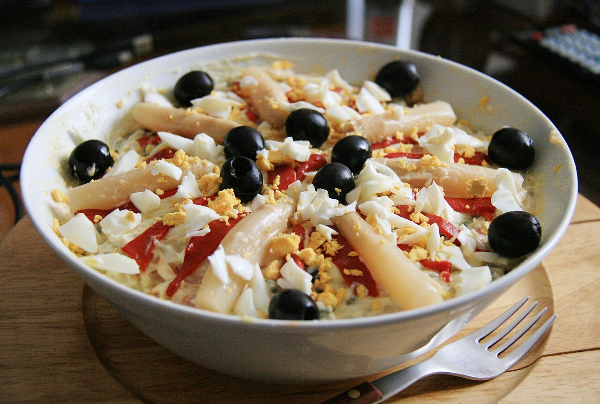

# Spanish potato salad

*Photo: [Tamorlan ; reprocessed by Off-shell](https://commons.wikimedia.org/wiki/File:Ensaladilla_Rusa_-_Madrid_corrected.JPG), [CC BY-SA 3.0](https://creativecommons.org/licenses/by-sa/3.0/), via Wikimedia Commons.*

🥗 Serves **6** · ⏱️ 45 minutes (+ 1 hour chilling) · Difficulty: easy

*En español:* [Ensaladilla rusa](ensaladilla-rusa.es.md)

## Ingredients

- 2¼ lb potatoes (Yukon Gold)
- 2 carrots
- ¾ cup peas (fresh or frozen)
- 3 eggs
- 2 cans oil-packed tuna (about 7 oz drained)
- 12 pitted green olives
- 1 roasted red pepper or pimiento strips, for garnish
- Salt

**For the mayonnaise**

- 1 egg
- 1 cup sunflower oil (or half mild olive oil)
- 1 tablespoon lemon juice or vinegar
- Salt

## Directions

1. **Boil.** Cook the unpeeled potatoes and the carrots in salted water about 25 minutes, until tender. Add the peas for the last 5 minutes. Hard-boil the eggs separately for 10 minutes.
2. **Cool and dice.** Peel the potatoes and carrots and cut into small cubes. Chop two of the eggs and the olives.
3. **Mayonnaise.** Put the egg, lemon juice and salt in an immersion blender cup. Blend with the blender resting on the bottom while drizzling in the oil, lifting it slowly once it starts to emulsify.
4. **Mix.** Combine the potatoes, carrots, peas, egg, olives and tuna in a bowl. Fold in the mayonnaise little by little until creamy.
5. **Garnish and chill.** Spread a thin layer of mayonnaise on top and garnish with pepper strips and the remaining egg. Chill at least 1 hour.

## Tips

- **Boil potatoes whole and unpeeled:** they absorb less water and hold their shape.
- **Eat it fresh:** with homemade mayo, keep it cold and finish within 24 hours.
- **As a tapa:** serve with breadsticks or crackers.
