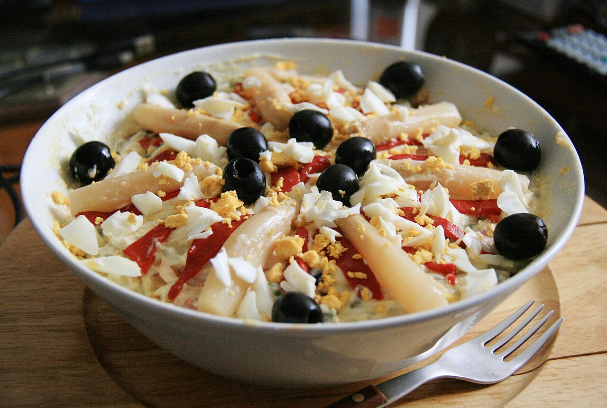

# Ensaladilla rusa

*Foto: [Tamorlan ; reprocessed by Off-shell](https://commons.wikimedia.org/wiki/File:Ensaladilla_Rusa_-_Madrid_corrected.JPG), [CC BY-SA 3.0](https://creativecommons.org/licenses/by-sa/3.0/deed.es), vía Wikimedia Commons.*

🥗 Para **6 personas** · ⏱️ 45 minutos (+ 1 hora de frío) · Dificultad: fácil

*In English:* [Spanish potato salad](ensaladilla-rusa.en.md)

## Ingredientes

- 1 kg de patatas
- 2 zanahorias
- 100 g de guisantes (frescos o congelados)
- 3 huevos
- 2 latas de atún o bonito en aceite (unos 200 g escurrido)
- 12 aceitunas verdes sin hueso
- 1 pimiento rojo asado o morrones en tiras, para decorar
- Sal

**Para la mayonesa**

- 1 huevo
- 250 ml de aceite de girasol (o mitad oliva suave)
- 1 cucharada de zumo de limón o vinagre
- Sal

## Preparación

1. **Cocer.** Cuece las patatas con piel y las zanahorias en agua con sal unos 25 minutos, hasta que estén tiernas. Añade los guisantes los últimos 5 minutos. Cuece los huevos 10 minutos aparte.
2. **Enfriar y cortar.** Pela las patatas y las zanahorias y córtalas en dados pequeños. Pica dos de los huevos y las aceitunas.
3. **La mayonesa.** Pon el huevo, el limón y la sal en el vaso de la batidora. Bate sin mover la batidora del fondo mientras añades el aceite en hilo, y súbela poco a poco cuando empiece a emulsionar.
4. **Mezclar.** Junta en un bol la patata, la zanahoria, los guisantes, el huevo, las aceitunas y el atún. Añade la mayonesa poco a poco hasta que quede cremosa.
5. **Decorar y enfriar.** Cubre con una capa fina de mayonesa y decora con tiras de pimiento y el huevo restante. Deja en la nevera al menos 1 hora.

## Consejos

- **Patata entera al cocerla:** con piel absorbe menos agua y no se deshace.
- **Fresca y del día:** con mayonesa casera, consúmela en 24 horas y siempre en frío.
- **Para picar:** sírvela con picos de pan o regañás.
