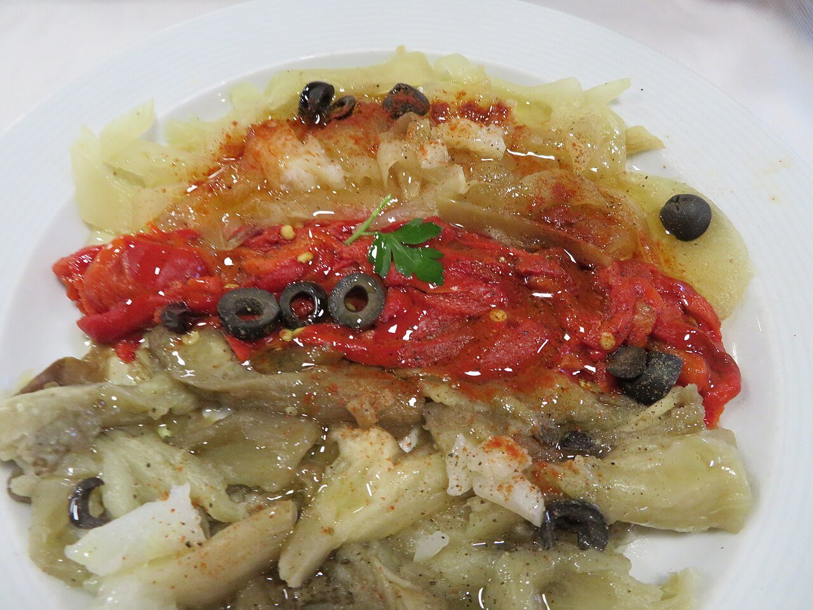

# Catalan roasted vegetables

*Photo: [Juan Emilio Prades Bel](https://commons.wikimedia.org/wiki/File:Escalivada,_verduras_asadas.jpg), [CC BY 4.0](https://creativecommons.org/licenses/by/4.0/), via Wikimedia Commons.*

🫑 Serves **4** · ⏱️ 1 hour 15 minutes · Difficulty: easy

*En español:* [Escalivada](escalivada.es.md)

## Ingredients

- 2 eggplants
- 2 large red bell peppers
- 2 onions
- 2 tomatoes (optional)
- 1 head of garlic (optional)
- Extra-virgin olive oil
- Flaky salt

## Directions

1. **Prep.** Rinse and dry the vegetables. Prick the eggplants with a fork. Rub everything with a little oil.
2. **Roast.** Place them whole on a baking sheet and roast at 400 °F: tomatoes come out after 30 minutes, peppers and eggplants around 45–50, and onions after an hour. Turn them halfway through.
3. **Steam.** Put the hot vegetables in a covered bowl (or wrap them in newspaper) for 15 minutes; this makes them much easier to peel.
4. **Peel and slice.** Peel the vegetables, seed the peppers and tear or cut everything into long strips.
5. **Dress.** Arrange on a platter, pour over the juices they released, add a generous drizzle of oil and flaky salt.

## Tips

- **Over embers:** the traditional flavor comes from a wood fire; use your grill if you have one.
- **Top with anchovies** or serve on toast rubbed with tomato.
- **Best warm** or at room temperature; keeps 3 days in the fridge.
