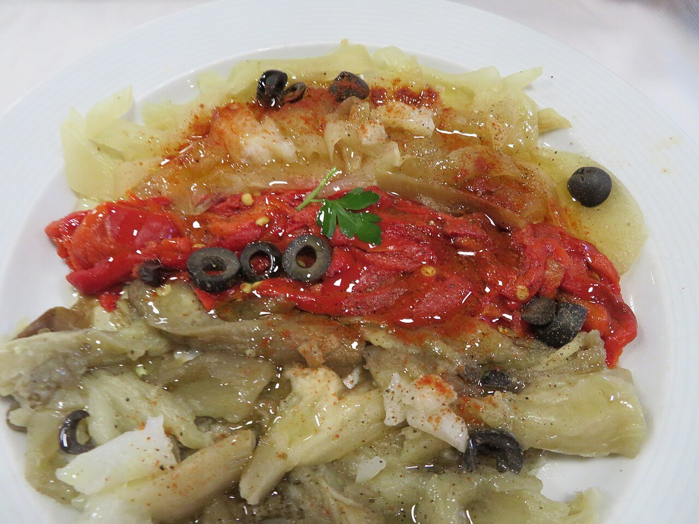

# Escalivada

*Foto: [Juan Emilio Prades Bel](https://commons.wikimedia.org/wiki/File:Escalivada,_verduras_asadas.jpg), [CC BY 4.0](https://creativecommons.org/licenses/by/4.0/deed.es), vía Wikimedia Commons.*

🫑 Para **4 personas** · ⏱️ 1 hora 15 minutos · Dificultad: fácil

*In English:* [Catalan roasted vegetables](escalivada.en.md)

## Ingredientes

- 2 berenjenas
- 2 pimientos rojos grandes
- 2 cebollas
- 2 tomates (opcional)
- 1 cabeza de ajos (opcional)
- Aceite de oliva virgen extra
- Sal en escamas

## Preparación

1. **Preparar.** Lava las verduras y sécalas. Pincha las berenjenas con un tenedor. Unta todo con un poco de aceite.
2. **Asar.** Ponlas enteras en una bandeja y ásalas en el horno a 200 °C: los tomates salen a los 30 minutos, los pimientos y las berenjenas hacia los 45–50, y las cebollas, a la hora. Dales la vuelta a mitad de cocción.
3. **Sudar.** Mete las verduras calientes en un bol tapado (o envuélvelas en papel de periódico) 15 minutos; así se pelan mucho mejor.
4. **Pelar y cortar.** Pela las verduras, quita las semillas de los pimientos y córtalo todo en tiras largas con las manos o con un cuchillo.
5. **Aliñar.** Colócalas en una fuente, riega con el jugo que hayan soltado, un buen chorro de aceite y sal en escamas.

## Consejos

- **A la brasa:** el sabor tradicional es con brasa de leña; si tienes barbacoa, aprovéchala.
- **Con anchoas** por encima o sobre una tostada de pan con tomate.
- **Mejor templada** o a temperatura ambiente; se conserva 3 días en la nevera.
