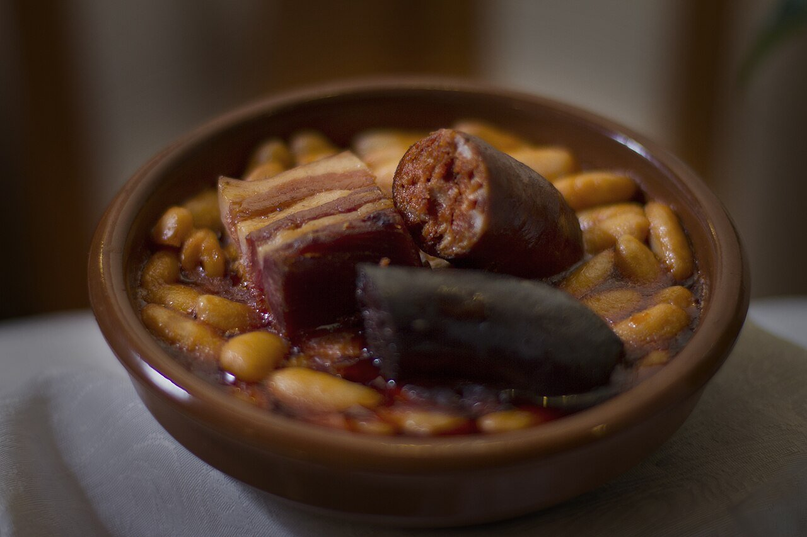

# Asturian bean stew

*Photo: [Flavio Lorenzo Sánchez](https://commons.wikimedia.org/wiki/File:Fabada_Asturiana_y_Compangu_(13231802453).jpg), [CC BY-SA 2.0](https://creativecommons.org/licenses/by-sa/2.0/), via Wikimedia Commons.*

🫘 Serves **6** · ⏱️ 3 hours (+ 12 hours soaking) · Difficulty: medium

*En español:* [Fabada asturiana](fabada-asturiana.es.md)

## Ingredients

- 1 lb fabes (large white Asturian beans) or large lima or butter beans
- 2 Asturian or smoked Spanish chorizos
- 2 Asturian morcillas (smoked blood sausage)
- 7 oz pork belly or salt pork
- 7 oz cured pork shoulder (optional)
- 1 pinch saffron
- Cold water and salt

## Directions

1. **Soak.** Soak the beans in cold water overnight (about 12 hours). If the pork is cured, soak it separately to remove salt.
2. **Start cooking.** Put the drained beans in a wide pot with the meats (chorizo, morcilla, pork belly and shoulder) and cover with cold water, about an inch above.
3. **"Scare" the beans.** Bring to a boil, skim and turn to the lowest heat. Whenever it boils hard, add a splash of cold water so the skins don't burst.
4. **Cook slowly.** Simmer 2–3 hours over very low heat, never stirring with a spoon: shake the pot by its handles instead. After an hour, add the toasted, crumbled saffron.
5. **Rest.** Taste for salt at the end (the meats are salty). Remove the meats, cut them into pieces and serve on the side or on top. Rest the stew 30 minutes before serving.

## Tips

- **Keep the beans whole:** never stir with a spoon and never let it boil hard.
- **Thicker broth:** mash a few beans and stir them back in.
- **Better rested:** like all stews, it improves by the next day.
