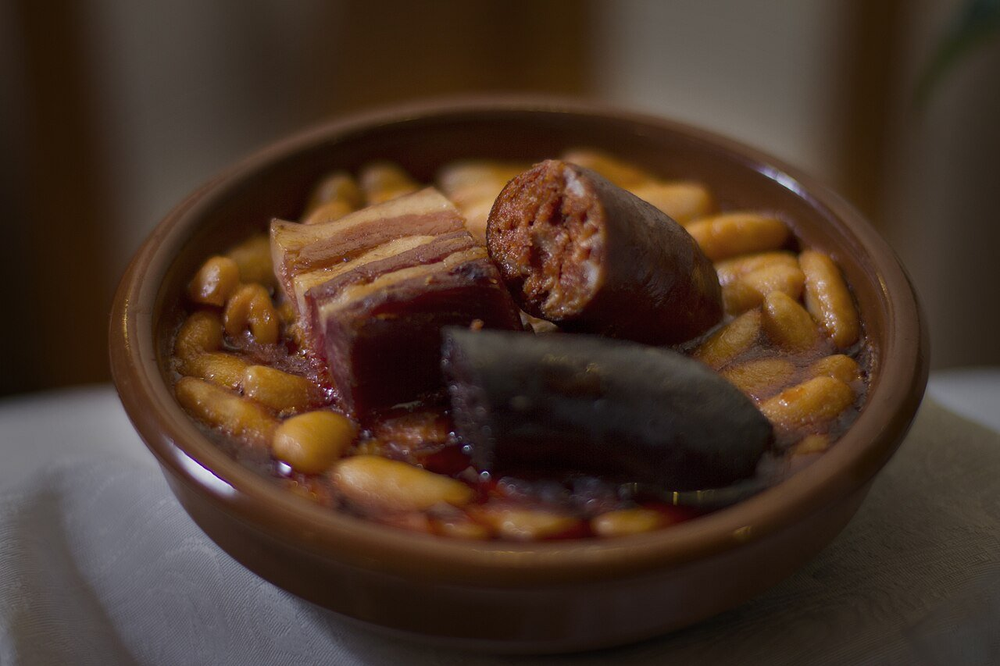

# Fabada asturiana

*Foto: [Flavio Lorenzo Sánchez](https://commons.wikimedia.org/wiki/File:Fabada_Asturiana_y_Compangu_(13231802453).jpg), [CC BY-SA 2.0](https://creativecommons.org/licenses/by-sa/2.0/deed.es), vía Wikimedia Commons.*

🫘 Para **6 personas** · ⏱️ 3 horas (+ 12 horas de remojo) · Dificultad: media

*In English:* [Asturian bean stew](fabada-asturiana.en.md)

## Ingredientes

- 500 g de fabes de la granja (alubias blancas grandes)
- 2 chorizos asturianos
- 2 morcillas asturianas
- 200 g de panceta o tocino
- 200 g de lacón (opcional)
- 1 pizca de azafrán
- Agua fría y sal

## Preparación

1. **Remojar.** Pon las fabes en remojo en agua fría la noche anterior (unas 12 horas). Si el lacón y la panceta son curados, desálalos en otro recipiente.
2. **Empezar la cocción.** Pon las fabes escurridas en una olla ancha con el compango (chorizo, morcilla, panceta y lacón) y cúbrelo todo con agua fría, unos dos dedos por encima.
3. **Asustar.** Lleva a ebullición, espuma y baja a fuego mínimo. Cada vez que hierva fuerte, añade un chorrito de agua fría ("asustar") para que la piel no se rompa.
4. **Cocer despacio.** Cuece 2–3 horas a fuego muy suave, sin remover nunca con cuchara: mueve la olla por las asas. A la hora, añade el azafrán tostado y desmenuzado.
5. **Reposar.** Prueba de sal al final (el compango ya sala). Saca el compango, córtalo en trozos y sírvelo aparte o encima. Deja reposar la fabada 30 minutos antes de servir.

## Consejos

- **Fabes enteras:** nunca remuevas con cuchara y no dejes que hierva fuerte.
- **Caldo espeso:** si hace falta, aplasta unas pocas fabes y mézclalas con el caldo.
- **Mejor reposada:** como todos los guisos de cuchara, gana al día siguiente.
