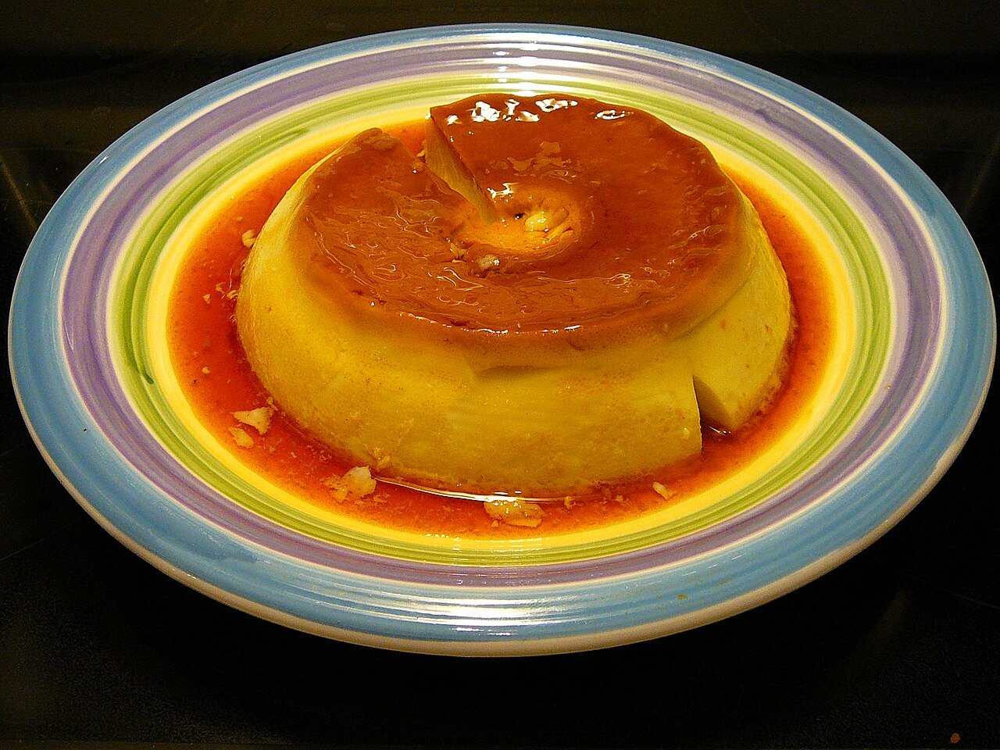

# Spanish egg flan

*Photo: [Cary Bass](https://commons.wikimedia.org/wiki/File:Homemade_Flan.jpg), [CC BY-SA 2.5](https://creativecommons.org/licenses/by-sa/2.5/), via Wikimedia Commons.*

🍮 Serves **6** · ⏱️ 1 hour 15 minutes (+ 4 hours chilling) · Difficulty: easy

*En español:* [Flan de huevo](flan-de-huevo.es.md)

## Ingredients

- 4 large eggs
- 2 cups whole milk
- ½ cup sugar
- Peel of ½ lemon (optional)
- 1 cinnamon stick (optional)

**For the caramel**

- ½ cup sugar
- 2 tablespoons water

## Directions

1. **Caramel.** Heat the sugar and water in a saucepan over medium heat, without stirring, until amber. Pour it right away into the mold (or individual ramekins) and swirl to coat the bottom.
2. **Infuse.** Heat the milk with the lemon peel and cinnamon. When it boils, remove from the heat, let cool slightly and strain.
3. **Custard.** Whisk the eggs with the sugar without making foam. Slowly stir in the warm milk.
4. **Water bath.** Pour into the mold over the caramel. Set it in a baking dish with hot water halfway up the sides and bake at 340 °F for 50–60 minutes (25–30 for ramekins), until a knife comes out clean.
5. **Chill and unmold.** Let cool and refrigerate at least 4 hours. Run a knife around the edge and invert onto a plate.

## Tips

- **No bubbles:** whisk gently and don't let the water bath boil.
- **Don't burn the caramel:** pull it off at amber; it keeps darkening off the heat.
- **Top with whipped cream**, the classic Spanish café way.
