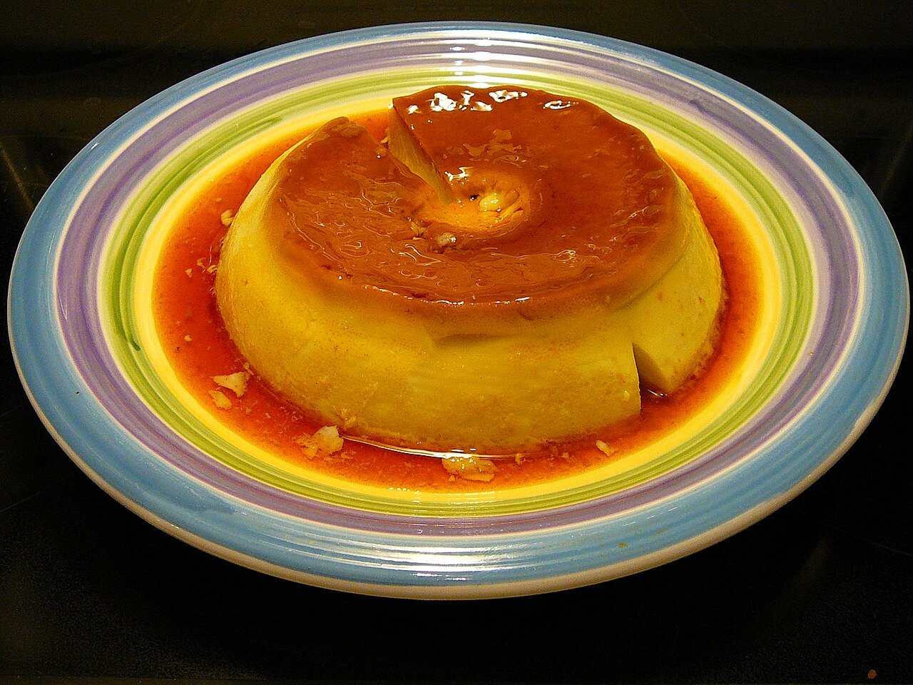

# Flan de huevo

*Foto: [Cary Bass](https://commons.wikimedia.org/wiki/File:Homemade_Flan.jpg), [CC BY-SA 2.5](https://creativecommons.org/licenses/by-sa/2.5/deed.es), vía Wikimedia Commons.*

🍮 Para **6 personas** · ⏱️ 1 hora 15 minutos (+ 4 horas de frío) · Dificultad: fácil

*In English:* [Spanish egg flan](flan-de-huevo.en.md)

## Ingredientes

- 4 huevos grandes
- 500 ml de leche entera
- 100 g de azúcar
- La piel de ½ limón (opcional)
- 1 rama de canela (opcional)

**Para el caramelo**

- 100 g de azúcar
- 2 cucharadas de agua

## Preparación

1. **El caramelo.** Calienta el azúcar con el agua en un cazo a fuego medio, sin remover, hasta que tome color ámbar. Viértelo enseguida en el molde (o en flaneras individuales) y repártelo por el fondo.
2. **Infusionar.** Calienta la leche con la piel de limón y la canela. Cuando hierva, retira y deja templar. Cuela.
3. **La mezcla.** Bate los huevos con el azúcar, sin hacer espuma. Añade la leche templada poco a poco y mezcla.
4. **Al baño maría.** Vierte la mezcla en el molde sobre el caramelo. Ponlo en una fuente con agua caliente hasta la mitad y hornea a 170 °C unos 50–60 minutos (25–30 en flaneras), hasta que al pinchar salga limpio.
5. **Enfriar y desmoldar.** Deja enfriar y mételo en la nevera al menos 4 horas. Pasa un cuchillo por el borde y desmolda sobre un plato.

## Consejos

- **Sin agujeros:** bate suave y no dejes que el agua del baño maría hierva.
- **Caramelo sin quemar:** cuando esté ámbar, retíralo; sigue oscureciendo fuera del fuego.
- **Con nata montada** por encima, a la manera clásica de los bares.
