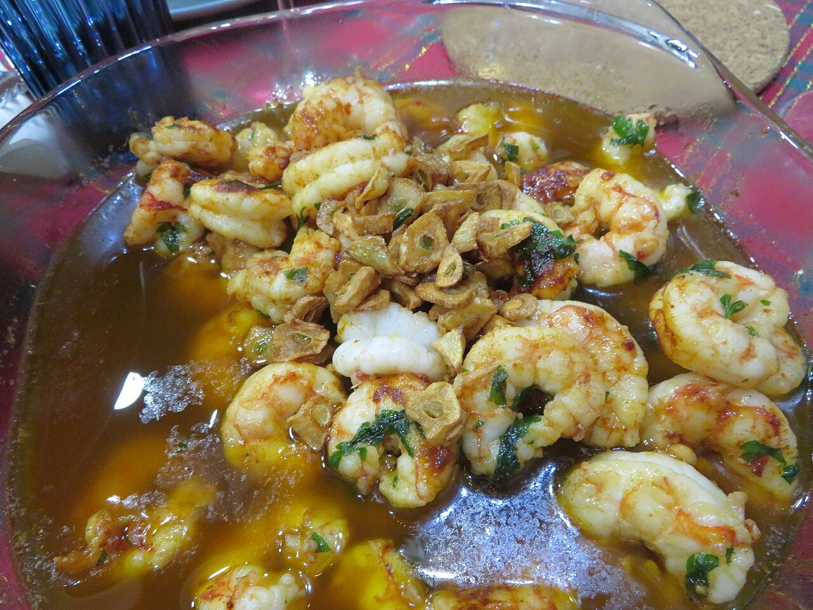

# Garlic shrimp

*Photo: [Juan Emilio Prades Bel](https://commons.wikimedia.org/wiki/File:Gambas_al_ajillo,_2024.jpg), [CC BY 4.0](https://creativecommons.org/licenses/by/4.0/), via Wikimedia Commons.*

🦐 Serves **4** · ⏱️ 15 minutes · Difficulty: easy

*En español:* [Gambas al ajillo](gambas-al-ajillo.es.md)

## Ingredients

- 1 lb raw peeled shrimp
- 6 garlic cloves, sliced
- 1–2 dried chiles (cayenne or chile de árbol)
- ⅔ cup extra-virgin olive oil
- 1 tablespoon chopped parsley
- Salt
- Crusty bread, for dipping

## Directions

1. **Prep.** Pat the shrimp dry and season lightly with salt.
2. **Garlic and chile.** Heat the oil in a small earthenware dish (or skillet) over medium-low heat. Add the garlic and broken chile and let the garlic turn just barely golden.
3. **Shrimp.** Turn up the heat, add the shrimp and cook 1–2 minutes, stirring, just until they turn pink.
4. **Serve.** Sprinkle with parsley and serve sizzling in the same dish, with bread for dipping.

## Tips

- **Juicy shrimp:** they cook in moments; as soon as they're pink, they're done.
- **Pale golden garlic:** if it browns too much, it turns bitter.
- **Extra touch:** a splash of white wine or brandy at the end, or a pinch of paprika.
