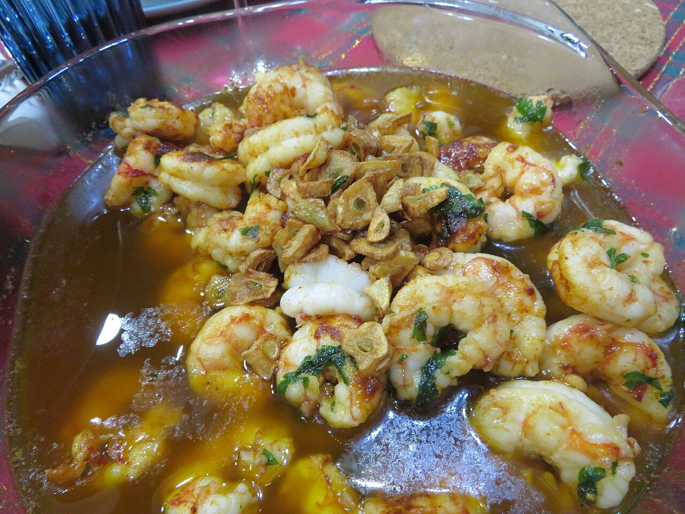

# Gambas al ajillo

*Foto: [Juan Emilio Prades Bel](https://commons.wikimedia.org/wiki/File:Gambas_al_ajillo,_2024.jpg), [CC BY 4.0](https://creativecommons.org/licenses/by/4.0/deed.es), vía Wikimedia Commons.*

🦐 Para **4 personas** · ⏱️ 15 minutos · Dificultad: fácil

*In English:* [Garlic shrimp](gambas-al-ajillo.en.md)

## Ingredientes

- 500 g de gambas peladas (crudas)
- 6 dientes de ajo en láminas
- 1–2 guindillas secas (cayenas)
- 150 ml de aceite de oliva virgen extra
- 1 cucharada de perejil picado
- Sal
- Pan, para mojar

## Preparación

1. **Preparar.** Seca bien las gambas y sálalas ligeramente.
2. **Ajo y guindilla.** Calienta el aceite en una cazuelita de barro (o sartén) a fuego medio-bajo. Añade el ajo y la guindilla troceada y deja que el ajo se dore muy poco, sin quemarse.
3. **Las gambas.** Sube el fuego, echa las gambas y cocínalas 1–2 minutos, removiendo, solo hasta que cambien de color.
4. **Servir.** Espolvorea el perejil y sirve en la misma cazuela, chisporroteando, con pan para mojar.

## Consejos

- **Gambas jugosas:** se hacen en muy poco tiempo; en cuanto estén rosadas, al plato.
- **El ajo, dorado claro:** si se tuesta de más, amarga.
- **Un toque extra:** un chorrito de vino blanco o brandy al final, o una pizca de pimentón.
