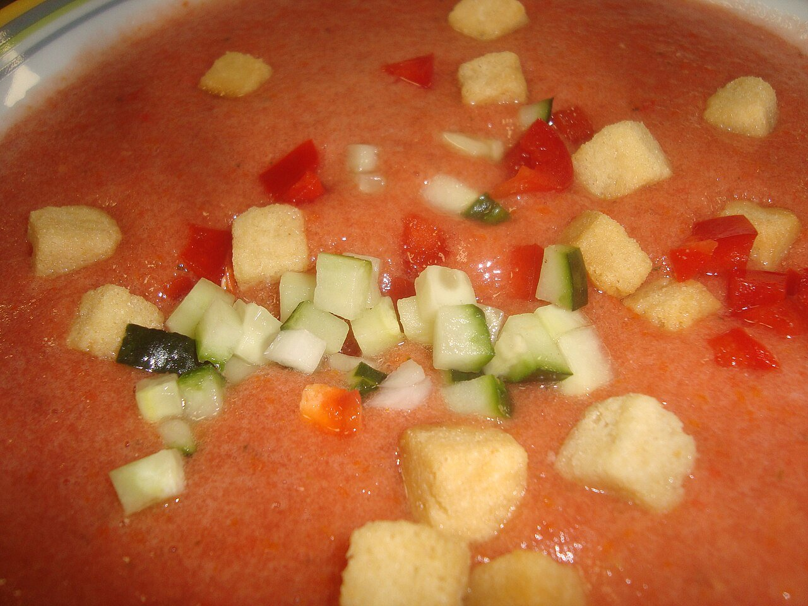

# Andalusian gazpacho

*Photo: [Juan Emilio Prades Bel](https://commons.wikimedia.org/wiki/File:Gazpacho_andaluz.jpg), [CC BY-SA 4.0](https://creativecommons.org/licenses/by-sa/4.0/), via Wikimedia Commons.*

🍅 Serves **4** · ⏱️ 15 minutes + 2 hours chilling · Difficulty: easy

*En español:* [Gazpacho andaluz](gazpacho-andaluz.es.md)

## Ingredients

- 2¼ lb very ripe tomatoes (Roma or vine)
- 1 Italian green pepper (or ½ green bell pepper)
- ½ cucumber
- 1 garlic clove
- 1 slice (about 2 oz) day-old bread (optional)
- ⅓ cup extra-virgin olive oil
- 2–3 tablespoons sherry vinegar
- ⅔ cup cold water (optional)
- Salt

**To garnish:** diced cucumber, pepper, onion, tomato and croutons.

## Directions

1. **Chop.** Rinse the tomatoes, pepper and cucumber. Cut into chunks, seeding the pepper. Peel the cucumber if the skin is thick. Soak the bread in water and squeeze it dry.
2. **Blend.** Blend the vegetables with the garlic, bread and a pinch of salt until very smooth.
3. **Emulsify.** With the blender running, drizzle in the oil, then the vinegar. Thin with cold water if you like it lighter.
4. **Strain and chill.** Pass through a fine sieve, adjust salt and vinegar and refrigerate at least 2 hours.
5. **Serve.** Serve ice-cold, in glasses or bowls, with the garnishes on the side.

## Tips

- **Use the best tomatoes:** gazpacho depends on their ripeness and flavor.
- **Orange color:** well-emulsified oil gives it that hue and a creamy texture.
- **Keeps** 3 days in the fridge in a glass bottle.
