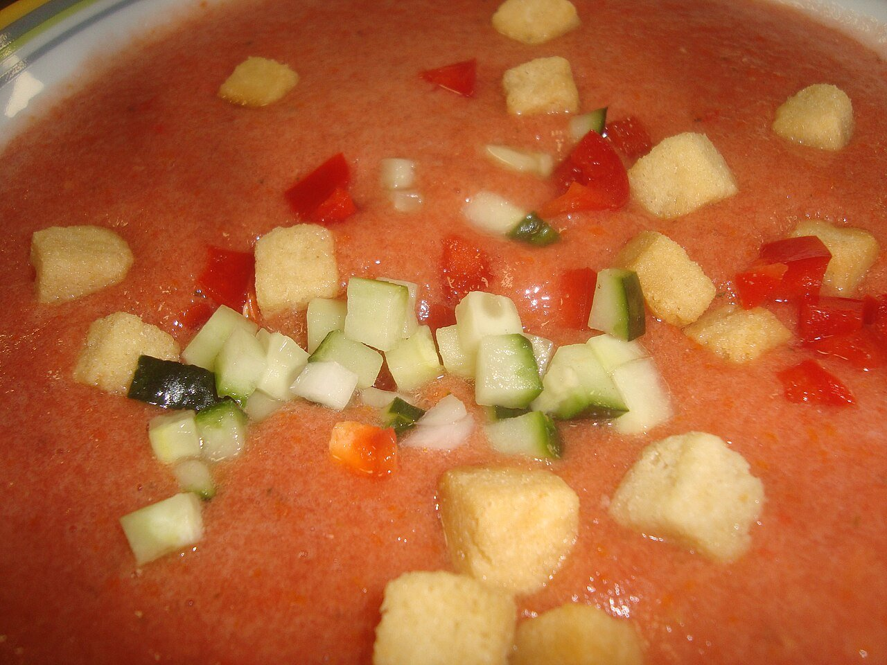

# Gazpacho andaluz

*Foto: [Juan Emilio Prades Bel](https://commons.wikimedia.org/wiki/File:Gazpacho_andaluz.jpg), [CC BY-SA 4.0](https://creativecommons.org/licenses/by-sa/4.0/deed.es), vía Wikimedia Commons.*

🍅 Para **4 personas** · ⏱️ 15 minutos + 2 horas de frío · Dificultad: fácil

*In English:* [Andalusian gazpacho](gazpacho-andaluz.en.md)

## Ingredientes

- 1 kg de tomates muy maduros (de pera o de rama)
- 1 pimiento verde italiano
- ½ pepino
- 1 diente de ajo
- 50 g de pan del día anterior (opcional)
- 80 ml de aceite de oliva virgen extra
- 2–3 cucharadas de vinagre de Jerez
- 150 ml de agua fría (opcional)
- Sal

**Para la guarnición:** dados de pepino, pimiento, cebolla, tomate y picatostes.

## Preparación

1. **Trocear.** Lava los tomates, el pimiento y el pepino. Trocéalos, quitando las semillas del pimiento. Pela el pepino si su piel es gruesa. Remoja el pan en agua y escúrrelo.
2. **Triturar.** Tritura las verduras con el ajo, el pan y una pizca de sal hasta que quede muy fino.
3. **Emulsionar.** Con la batidora en marcha, añade el aceite en hilo y luego el vinagre. Aclara con agua fría si lo quieres más ligero.
4. **Colar y enfriar.** Pásalo por un colador fino o chino, ajusta de sal y vinagre y refrigéralo al menos 2 horas.
5. **Servir.** Sírvelo muy frío, en vaso o en cuenco, con la guarnición aparte.

## Consejos

- **Tomate, el mejor:** el gazpacho depende de su madurez y sabor.
- **Color anaranjado:** el aceite bien emulsionado le da ese tono y la textura cremosa.
- **Se conserva** 3 días en la nevera en una botella de cristal.
