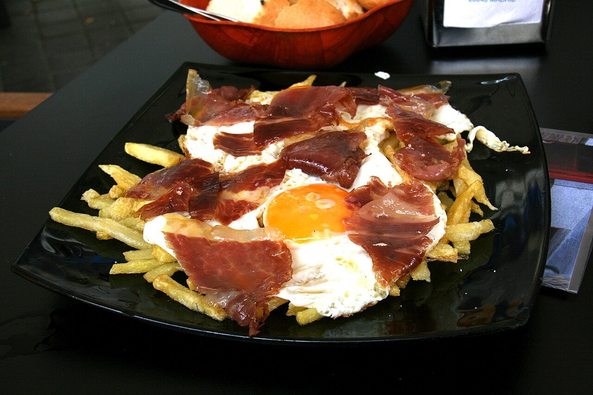

# Broken eggs with fries and serrano ham

*Photo: [Tamorlan](https://commons.wikimedia.org/wiki/File:Huevos_rotos_-_Madrid.JPG), [CC BY-SA 3.0](https://creativecommons.org/licenses/by-sa/3.0/), via Wikimedia Commons.*

🍳 Serves **4** · ⏱️ 35 minutes · Difficulty: easy

*En español:* [Huevos rotos con jamón](huevos-rotos-con-jamon.es.md)

## Ingredients

- 4 large potatoes (about 1¾ lb)
- 4–6 free-range eggs
- 3½ oz thinly sliced serrano or Ibérico ham
- Olive oil, for frying
- Flaky salt

## Directions

1. **Cut.** Peel the potatoes and cut into sticks or thin slices. Rinse and pat very dry.
2. **Fry the potatoes.** Fry in plenty of oil over medium heat for about 10 minutes so they cook through. Raise the heat at the end to brown them. Drain, salt and spread on a platter.
3. **Fry the eggs.** In very hot oil, fry the eggs one at a time, basting the whites with oil, until the edges are crispy and the yolks still runny.
4. **Assemble.** Lay the eggs over the potatoes and drape the ham on top.
5. **Break.** At the table, break the eggs with a fork and toss everything so the yolk coats the potatoes.

## Tips

- **Two temperatures for the potatoes:** gentle to cook through, hot to brown.
- **Runny yolks:** that's the whole point; don't overcook the eggs.
- **Variations:** with chistorra or chorizo sausage, Padrón peppers or baby eels.
