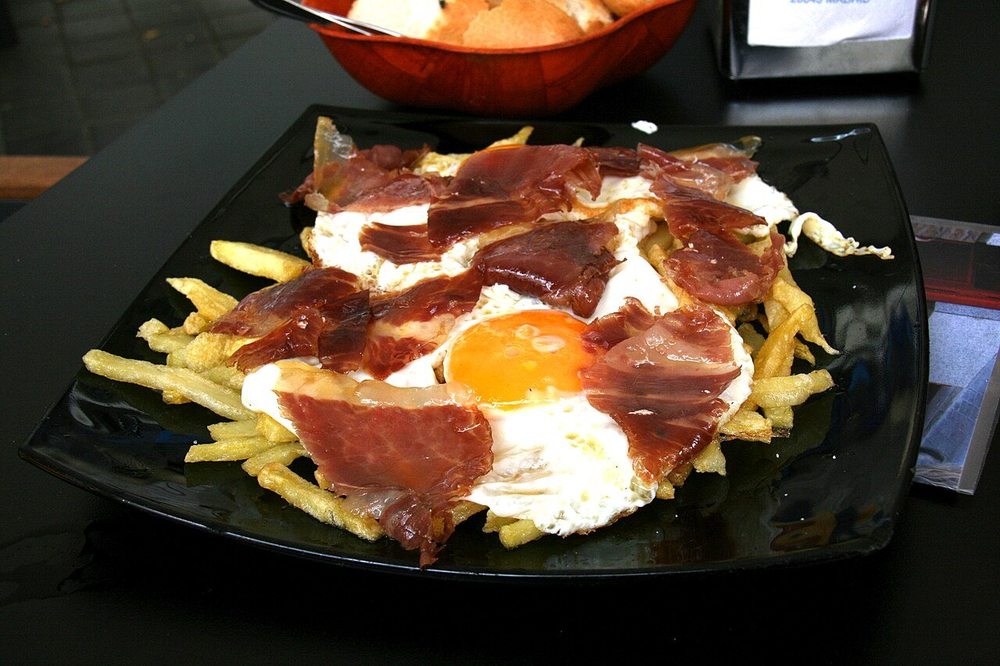

# Huevos rotos con jamón

*Foto: [Tamorlan](https://commons.wikimedia.org/wiki/File:Huevos_rotos_-_Madrid.JPG), [CC BY-SA 3.0](https://creativecommons.org/licenses/by-sa/3.0/deed.es), vía Wikimedia Commons.*

🍳 Para **4 personas** · ⏱️ 35 minutos · Dificultad: fácil

*In English:* [Broken eggs with fries and serrano ham](huevos-rotos-con-jamon.en.md)

## Ingredientes

- 4 patatas grandes (unos 800 g)
- 4–6 huevos camperos
- 100 g de jamón serrano o ibérico en lonchas finas
- Aceite de oliva, para freír
- Sal en escamas

## Preparación

1. **Cortar.** Pela las patatas y córtalas en bastones o en láminas finas. Lávalas y sécalas bien.
2. **Freír las patatas.** Fríelas en abundante aceite a fuego medio unos 10 minutos para que se hagan por dentro. Sube el fuego al final para dorarlas. Escúrrelas, sálalas y repártelas en una fuente.
3. **Freír los huevos.** En aceite bien caliente, fríe los huevos de uno en uno, regando la clara con el aceite, hasta que la puntilla esté crujiente y la yema siga líquida.
4. **Montar.** Coloca los huevos sobre las patatas y el jamón por encima.
5. **Romper.** En la mesa, rompe los huevos con un tenedor y mézclalo todo para que la yema empape las patatas.

## Consejos

- **Patatas a dos temperaturas:** primero suaves para que se hagan, después fuertes para que se doren.
- **Yema líquida:** es la gracia del plato; no cocines de más el huevo.
- **Variantes:** con chistorra, chorizo, pimientos de Padrón o gulas.
