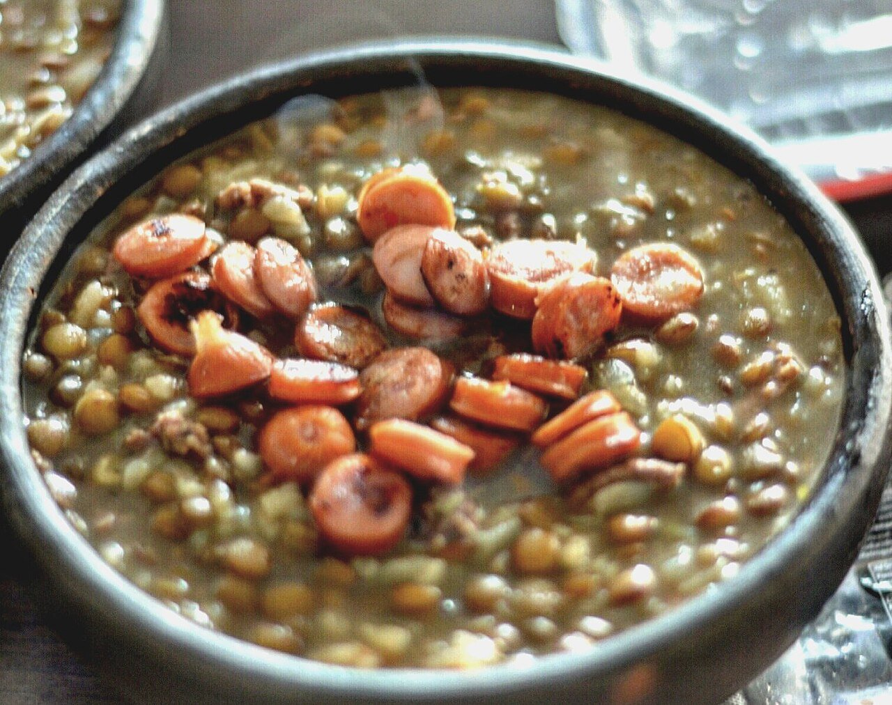

# Spanish lentil stew with chorizo

*Photo: [mariela morales](https://commons.wikimedia.org/wiki/File:Lentejas_con_chorizo_-_Flickr_-_Marieloreto.jpg), [CC0](https://creativecommons.org/publicdomain/zero/1.0/), via Wikimedia Commons.*

🥣 Serves **4** · ⏱️ 1 hour · Difficulty: easy

*En español:* [Lentejas con chorizo](lentejas-con-chorizo.es.md)

## Ingredients

- 1½ cups small brown lentils (pardina or green/French lentils)
- 1 cooking chorizo (about 5 oz)
- 1 onion
- 1 green bell pepper
- 1 carrot
- 2 garlic cloves
- 1 ripe tomato, grated
- 1 medium potato
- 1 bay leaf
- 1 teaspoon sweet smoked paprika (pimentón)
- 3 tablespoons olive oil
- 6 cups water or stock
- Salt

## Directions

1. **Rinse.** Rinse the lentils in cold water and drain. Small lentils need no soaking.
2. **Sofrito.** In a pot, heat the oil and cook the chopped onion, pepper, carrot and garlic for 10 minutes. Add the tomato and cook 5 minutes more.
3. **Paprika and chorizo.** Add the sliced chorizo and sauté 2 minutes. Off the heat, stir in the paprika.
4. **Simmer.** Add the lentils, bay leaf and cold water. Bring to a boil and simmer gently for 30 minutes.
5. **Potato.** Add the potato, peeled and broken into chunks, and salt. Cook 15–20 minutes more, until the lentils are tender and the broth has thickened.

## Tips

- **Small lentils:** they hold their shape and don't need soaking.
- **A splash of vinegar** at the table brightens the flavor.
- **Better the next day**, like most stews.
