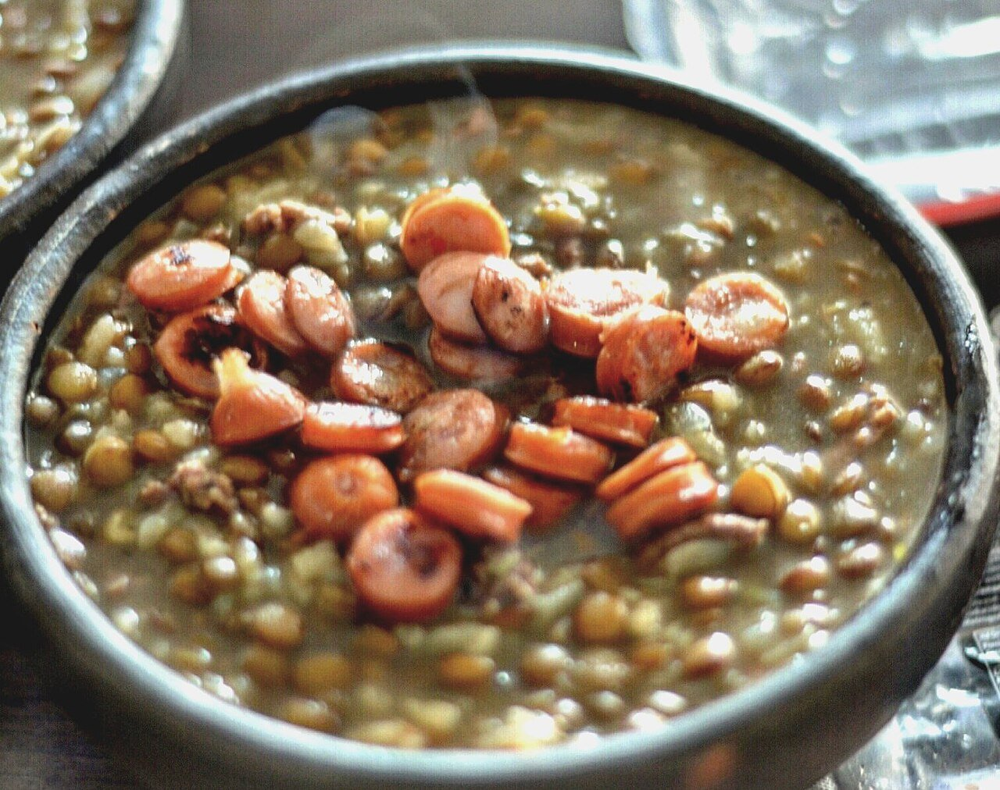

# Lentejas con chorizo

*Foto: [mariela morales](https://commons.wikimedia.org/wiki/File:Lentejas_con_chorizo_-_Flickr_-_Marieloreto.jpg), [CC0](https://creativecommons.org/publicdomain/zero/1.0/deed.es), vía Wikimedia Commons.*

🥣 Para **4 personas** · ⏱️ 1 hora · Dificultad: fácil

*In English:* [Spanish lentil stew with chorizo](lentejas-con-chorizo.en.md)

## Ingredientes

- 300 g de lentejas pardinas
- 1 chorizo para guisar (unos 150 g)
- 1 cebolla
- 1 pimiento verde
- 1 zanahoria
- 2 dientes de ajo
- 1 tomate maduro rallado
- 1 patata mediana
- 1 hoja de laurel
- 1 cucharadita de pimentón dulce
- 3 cucharadas de aceite de oliva
- 1,5 litros de agua o caldo
- Sal

## Preparación

1. **Lavar.** Lava las lentejas en agua fría y escúrrelas. Las pardinas no necesitan remojo.
2. **Sofrito.** En una olla, calienta el aceite y pocha la cebolla, el pimiento, la zanahoria y el ajo picados durante 10 minutos. Añade el tomate y cocina 5 minutos más.
3. **Pimentón y chorizo.** Añade el chorizo en rodajas y rehoga 2 minutos. Fuera del fuego, echa el pimentón y remueve.
4. **Cocer.** Añade las lentejas, el laurel y el agua fría. Lleva a ebullición y cuece a fuego suave 30 minutos.
5. **La patata.** Añade la patata pelada y cascada en trozos y sal. Cuece 15–20 minutos más, hasta que las lentejas estén tiernas y el caldo haya espesado.

## Consejos

- **Pardinas:** son pequeñas, no se deshacen y no requieren remojo.
- **Un chorrito de vinagre** al servir realza el sabor y ayuda a absorber el hierro.
- **Mejor de un día para otro**, como casi todos los guisos.
