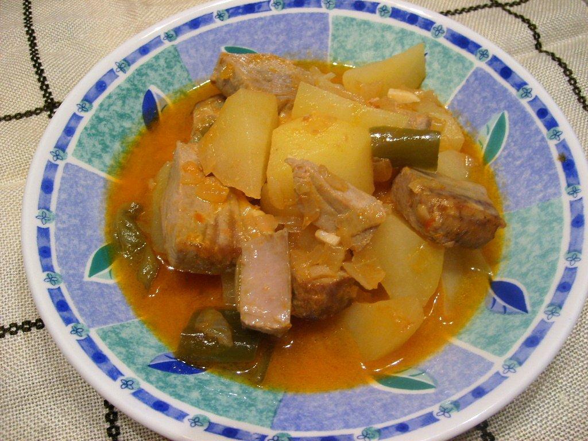

# Basque tuna and potato stew

*Photo: [Núria Pueyo](https://commons.wikimedia.org/wiki/File:Marmitako.JPG), [CC BY-SA 2.5](https://creativecommons.org/licenses/by-sa/2.5/), via Wikimedia Commons.*

🐟 Serves **4** · ⏱️ 50 minutes · Difficulty: easy

*En español:* [Marmitako](marmitako.es.md)

## Ingredients

- 1⅓ lb albacore or other fresh tuna, cubed
- 2¼ lb potatoes
- 1 onion
- 1 green bell pepper
- 2 garlic cloves
- 2 tablespoons choricero pepper paste (or 1 teaspoon sweet paprika)
- 1 ripe tomato, grated
- 4 cups hot fish stock
- 4 tablespoons olive oil
- Salt and parsley

## Directions

1. **Sofrito.** In a Dutch oven, cook the chopped onion, pepper and garlic in the oil for 10 minutes. Add the tomato and pepper paste and cook 5 minutes more.
2. **Potatoes.** Peel the potatoes and break them into chunks (snap them with the knife instead of slicing). Add them and stir 2 minutes.
3. **Simmer.** Cover with the hot stock, add salt and simmer over medium heat 20–25 minutes, until the potatoes are tender and the broth thickens.
4. **Tuna.** Season the tuna and add it to the pot. Turn off the heat, cover and let sit 5 minutes: the residual heat cooks it.
5. **Serve.** Sprinkle with chopped parsley and serve right away.

## Tips

- **Juicy tuna:** never let it boil; it cooks in the heat of the broth.
- **Season:** albacore is at its best from June to September.
- **Thicker broth:** mash a couple of potato chunks against the pot.
