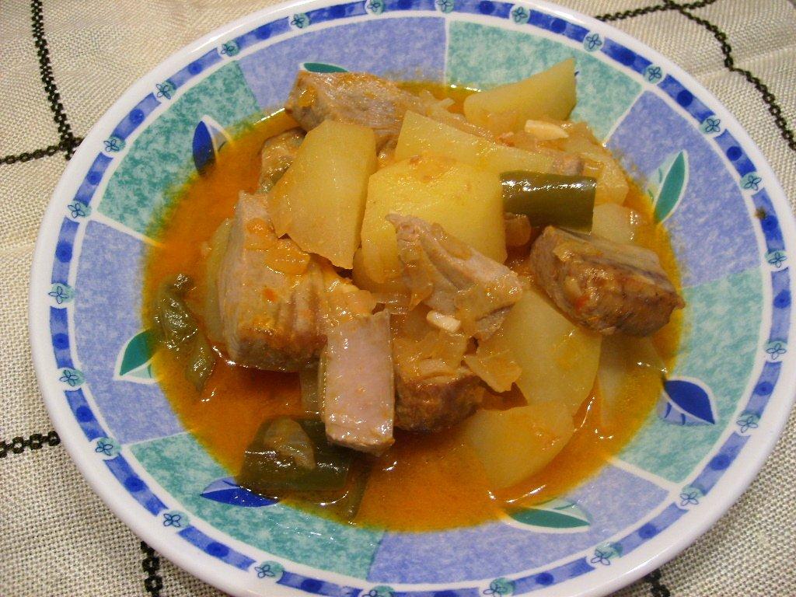

# Marmitako

*Foto: [Núria Pueyo](https://commons.wikimedia.org/wiki/File:Marmitako.JPG), [CC BY-SA 2.5](https://creativecommons.org/licenses/by-sa/2.5/deed.es), vía Wikimedia Commons.*

🐟 Para **4 personas** · ⏱️ 50 minutos · Dificultad: fácil

*In English:* [Basque tuna and potato stew](marmitako.en.md)

## Ingredientes

- 600 g de bonito del norte (o atún) limpio, en dados
- 1 kg de patatas
- 1 cebolla
- 1 pimiento verde
- 2 dientes de ajo
- 2 cucharadas de carne de pimiento choricero (o 1 cucharadita de pimentón dulce)
- 1 tomate maduro rallado
- 1 litro de caldo de pescado caliente
- 4 cucharadas de aceite de oliva
- Sal y perejil

## Preparación

1. **Sofrito.** En una cazuela, pocha la cebolla, el pimiento y el ajo picados en el aceite durante 10 minutos. Añade el tomate y la carne de choricero y cocina 5 minutos más.
2. **Las patatas.** Pela las patatas y cáscalas en trozos (romperlas con el cuchillo en vez de cortarlas). Añádelas a la cazuela y rehoga 2 minutos.
3. **Cocer.** Cubre con el caldo caliente, sala y cuece a fuego medio 20–25 minutos, hasta que las patatas estén tiernas y el caldo espese.
4. **El bonito.** Sala los dados de bonito y añádelos a la cazuela. Apaga el fuego, tapa y deja 5 minutos: el calor residual basta para cocinarlo.
5. **Servir.** Espolvorea perejil picado y sirve enseguida.

## Consejos

- **Bonito jugoso:** nunca debe hervir; se hace en el calor del caldo.
- **Temporada:** el bonito del norte está en su mejor momento de junio a septiembre.
- **Más espeso:** aplasta un par de trozos de patata contra la cazuela.
