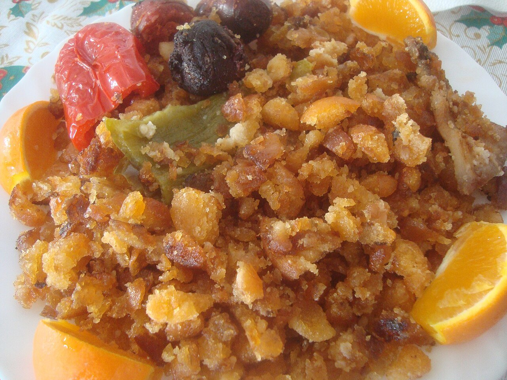

# Extremaduran fried breadcrumbs with chorizo

*Photo: [Juan Emilio Prades Bel](https://commons.wikimedia.org/wiki/File:Migas,_un_plato_t%C3%ADpico_de_la_cocina_espa%C3%B1ola.jpg), [CC BY-SA 4.0](https://creativecommons.org/licenses/by-sa/4.0/), via Wikimedia Commons.*

🍞 Serves **4** · ⏱️ 40 minutes (+ 12 hours resting the bread) · Difficulty: easy

*En español:* [Migas extremeñas](migas-extremenas.es.md)

## Ingredients

- 1 lb stale rustic country bread (2–3 days old)
- ⅔ cup salted water
- 6 unpeeled garlic cloves
- 5 oz pork belly or bacon, diced
- 1 Spanish chorizo, sliced
- 2 green bell peppers (optional)
- 1 teaspoon smoked paprika (pimentón de la Vera)
- 6 tablespoons olive oil
- Grapes or a fried egg, to serve

## Directions

1. **Dampen the bread.** The night before, cut the bread into small pieces or thin slices. Sprinkle with the salted water, toss, cover with a damp towel and let it rest.
2. **Garlic and meat.** In a large skillet, fry the crushed unpeeled garlic in the oil. Add the pork belly, chorizo and pepper strips, brown them and remove.
3. **Paprika.** Take the skillet off the heat, stir the paprika into the oil and add the bread right away.
4. **Stir.** Return to medium-low heat and stir the bread constantly, breaking it with a spatula, for about 20 minutes, until loose and golden.
5. **Combine.** Return the meat and peppers, toss and serve with grapes or a fried egg.

## Tips

- **Dense rustic bread:** sandwich bread won't work; it turns gummy.
- **Patience:** the secret is long, gentle stirring.
- **Shepherd's dish:** born in the countryside from whatever was at hand; sardines, blood sausage or mushrooms all fit.
