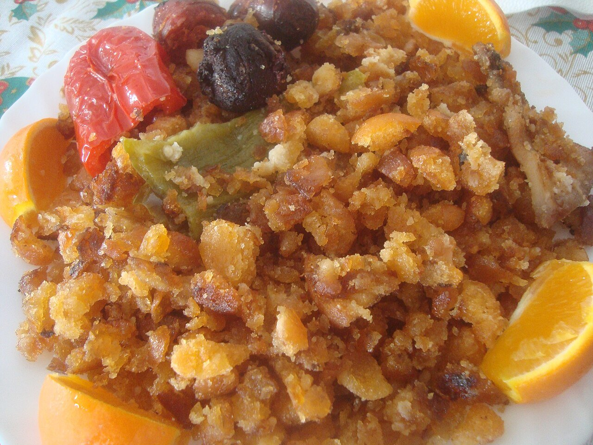

# Migas extremeñas

*Foto: [Juan Emilio Prades Bel](https://commons.wikimedia.org/wiki/File:Migas,_un_plato_t%C3%ADpico_de_la_cocina_espa%C3%B1ola.jpg), [CC BY-SA 4.0](https://creativecommons.org/licenses/by-sa/4.0/deed.es), vía Wikimedia Commons.*

🍞 Para **4 personas** · ⏱️ 40 minutos (+ 12 horas de reposo del pan) · Dificultad: fácil

*In English:* [Extremaduran fried breadcrumbs with chorizo](migas-extremenas.en.md)

## Ingredientes

- 500 g de pan de pueblo duro (de 2–3 días)
- 150 ml de agua con sal
- 6 dientes de ajo con piel
- 150 g de panceta o tocino en dados
- 1 chorizo en rodajas
- 2 pimientos verdes (opcional)
- 1 cucharadita de pimentón de la Vera
- 6 cucharadas de aceite de oliva
- Uvas o un huevo frito, para acompañar

## Preparación

1. **Humedecer el pan.** La noche anterior, corta el pan en trocitos o láminas finas. Rocíalo con el agua con sal, mezcla, tapa con un paño húmedo y deja reposar.
2. **Ajos y carnes.** En una sartén grande, fríe los ajos chafados con piel en el aceite. Añade la panceta, el chorizo y los pimientos en tiras, dóralos y sácalos.
3. **Pimentón.** Retira la sartén del fuego, añade el pimentón al aceite y echa el pan enseguida.
4. **Remover.** Vuelve al fuego medio-bajo y remueve el pan sin parar, cortándolo con la paleta, unos 20 minutos, hasta que esté suelto y dorado.
5. **Juntar.** Devuelve las carnes y los pimientos, mezcla y sirve con uvas o un huevo frito.

## Consejos

- **El pan, de miga densa:** el de molde no sirve; se apelmaza.
- **Paciencia:** el secreto es remover mucho rato, a fuego suave.
- **Migas de pastor:** el plato nació en el campo, con lo que había a mano; admite sardinas, morcilla o setas.
