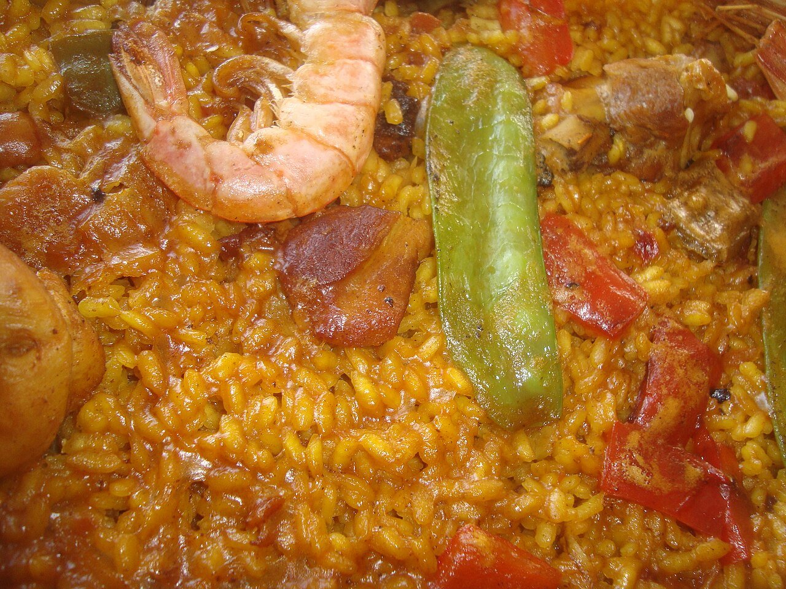

# Valencian paella

*Photo: [Juan Emilio Prades Bel](https://commons.wikimedia.org/wiki/File:Paella,_plato_t%C3%ADpico_de_la_Comunidad_Valenciana_(Espa%C3%B1a).jpg), [CC BY-SA 4.0](https://creativecommons.org/licenses/by-sa/4.0/), via Wikimedia Commons.*

🥘 Serves **4** · ⏱️ 1 hour 15 minutes · Difficulty: medium

*En español:* [Paella valenciana](paella-valenciana.es.md)

## Ingredients

- 2 cups bomba or other short-grain Spanish rice
- 1⅓ lb chicken, cut into pieces
- 14 oz rabbit, cut into pieces (or more chicken)
- 7 oz flat green beans (Romano beans)
- 1 cup lima or butter beans, fresh or frozen
- 1 ripe tomato, grated
- 1 teaspoon sweet smoked paprika (pimentón)
- A pinch of saffron threads
- 1 sprig rosemary (optional)
- ⅓ cup extra-virgin olive oil
- 6 cups water
- Salt

## Directions

1. **Brown the meat.** Heat the oil in a paella pan, sprinkle salt in the center and brown the chicken and rabbit well over medium heat, about 15 minutes.
2. **Vegetables.** Push the meat to the edges and sauté the green beans and lima beans in the center 5 minutes. Add the tomato and cook until its liquid evaporates. Stir in the paprika for a few seconds and pour in the water right away.
3. **Broth.** Add the saffron and salt. Simmer over medium heat about 25 minutes so the meat flavors the broth. The liquid should reach the rivets of the pan's handles.
4. **Rice.** Turn up the heat and scatter the rice in a cross, then spread it evenly. Cook 10 minutes over high heat and 8 more over low, **without stirring**. Lay the rosemary on top for the last few minutes.
5. **Socarrat and rest.** Raise the heat for the last minute to toast the bottom. Remove from heat, cover with a towel and rest 5 minutes.

## Tips

- **Never stir** once the rice is in: paella isn't risotto.
- **Use a wide pan** and keep the rice layer thin, about ½ inch.
- **Traditional rules:** in Valencia, no chorizo or onion, and it's eaten straight from the pan.
