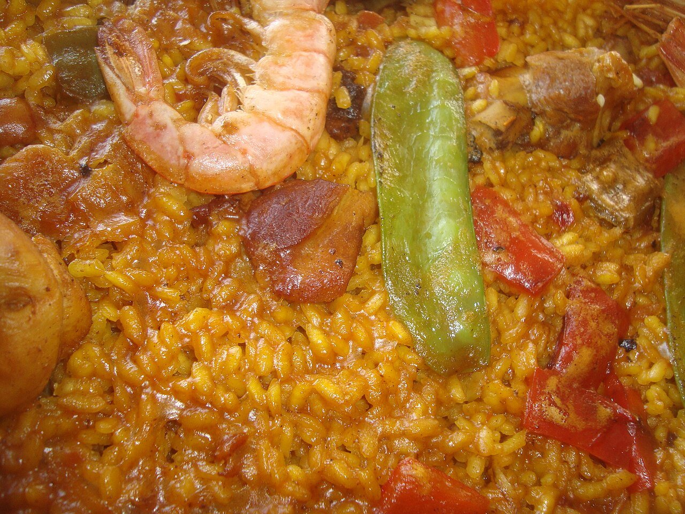

# Paella valenciana

*Foto: [Juan Emilio Prades Bel](https://commons.wikimedia.org/wiki/File:Paella,_plato_t%C3%ADpico_de_la_Comunidad_Valenciana_(Espa%C3%B1a).jpg), [CC BY-SA 4.0](https://creativecommons.org/licenses/by-sa/4.0/deed.es), vía Wikimedia Commons.*

🥘 Para **4 personas** · ⏱️ 1 hora 15 minutos · Dificultad: media

*In English:* [Valencian paella](paella-valenciana.en.md)

## Ingredientes

- 400 g de arroz bomba o redondo (tipo Senia o Bahía)
- 600 g de pollo troceado
- 400 g de conejo troceado
- 200 g de judía verde plana (ferraura)
- 150 g de garrofó (judión blanco), fresco o congelado
- 1 tomate maduro rallado
- 1 cucharadita de pimentón dulce
- Unas hebras de azafrán (o colorante)
- 1 ramita de romero (opcional)
- 100 ml de aceite de oliva virgen extra
- 1,5 litros de agua
- Sal

## Preparación

1. **Dorar la carne.** Calienta el aceite en la paellera, pon sal en el centro y dora bien el pollo y el conejo a fuego medio, unos 15 minutos, hasta que estén dorados por todos lados.
2. **Verduras.** Aparta la carne a los bordes y rehoga en el centro la judía verde y el garrofó 5 minutos. Añade el tomate y sofríe hasta que pierda el agua. Echa el pimentón, remueve unos segundos y vierte el agua enseguida.
3. **El caldo.** Añade el azafrán y sal. Cuece a fuego medio unos 25 minutos para que la carne suelte el sabor. El caldo debe llegar a los remaches de las asas.
4. **El arroz.** Sube el fuego y reparte el arroz en forma de cruz; extiéndelo por igual. Cuece 10 minutos a fuego fuerte y 8 más a fuego suave, **sin remover**. Pon el romero encima los últimos minutos.
5. **Socarrat y reposo.** Sube el fuego el último minuto para que se tueste el fondo. Retira, cubre con un paño y deja reposar 5 minutos.

## Consejos

- **Nunca remover** tras echar el arroz: la paella no es un risotto.
- **Paellera ancha** y capa fina de arroz, de un dedo de grosor.
- **Lo tradicional:** en Valencia, ni chorizo ni cebolla, y se come directamente de la paellera.
